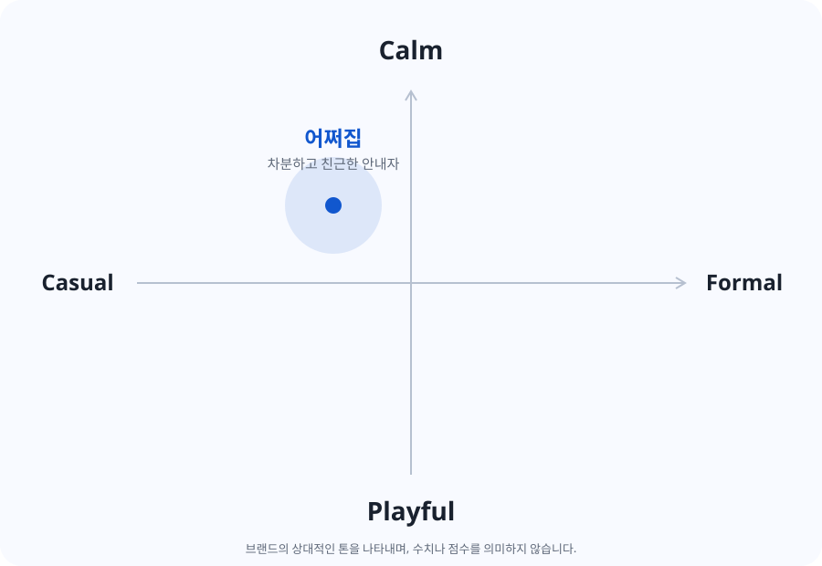

# 어쩌집 UX 라이팅 가이드

최종 작성 기준 · 2026-11-09

이 문서는 어쩌집의 브랜드 보이스와 상황별 톤, 화면 문구 작성 기준을 정리한다. 사용자 제공 코어 밸류·톤맵과 W10 문구 수정 이력을 바탕으로 작성했다. **작성 기준의 최종본이며, 모든 화면 문구의 적용 완료나 약관의 법적 확정을 의미하지 않는다.**

## 1. 브랜드 소개

어쩌집은 혼자 사는 사람이 집에서 생긴 문제를 이해하고, 지금 할 수 있는 일을 찾도록 돕는 주거 문제 안내 서비스입니다.
직접 해결하는 방법부터 집주인이나 전문 업체에 도움을 요청하는 방법까지, 상황에 맞는 다음 행동을 차분하고 알기 쉽게 안내합니다.

## 2. 브랜드 보이스와 코어 밸류

**막막한 집 문제를 함께 살펴보고, 사용자가 다음 행동을 선택할 수 있도록 돕는 차분하고 친근한 안내자.**

친근함은 반말이나 장난스러운 표현보다 쉬운 말과 구체적인 도움으로 전달한다. 해결을 대신 보장하거나 사용자의 판단을 대신하지 않는다.

| 코어 밸류 | 문장에서 지킬 기준 | 피할 표현·방식 |
| --- | --- | --- |
| 정직한 | 확인한 사실과 가능성을 구분한다. AI의 한계와 실제 처리 상태를 정확히 알린다. | 모든 문제 해결 보장, 저장 전 접수 완료 안내, 근거 없는 시간·책임 단정 |
| 명확한 | 무엇을 입력하고 버튼을 누르면 무엇이 일어나는지 구체적으로 쓴다. | ‘확인’, ‘처리’, ‘내용 보완’만으로 끝나는 안내 |
| 실용적인 | 사용자가 지금 할 수 있는 행동을 제시한다. 직접 수리 외에 점검·문의도 해결 방법으로 다룬다. | 공감만 하고 다음 행동을 알려주지 않는 문장 |
| 존중하는 | 사용자가 확인하고 선택할 여지를 둔다. 실패를 사용자의 잘못으로 돌리지 않는다. | ‘잘못 입력하셨습니다’, 동의를 강요하는 표현, AI 판단을 무조건 따르게 하는 표현 |
| 공감하는 | 불편과 부담을 이해하는 짧은 말 뒤에 도움을 붙인다. | 과장된 위로, 불안을 키우는 감탄사, 위험 상황에서의 농담 |

## 3. 톤맵

제공된 톤맵은 가로축 **Casual ↔ Formal**, 세로축 **Playful ↔ Calm**이며, 어쩌집은 중심에서 **Casual 쪽으로 조금, Calm 쪽으로** 위치한다. 정확한 수치나 비율은 지정하지 않는다.

- 기본: 차분하고 친근한 해요체. 사용자의 말을 듣고 함께 상황을 살펴보는 태도.
- 첫 만남·해결 완료: 조금 더 따뜻하게. 반가움과 기쁨은 짧게 표현.
- 입력·분석·실패: 감정보다 사실과 다음 행동을 먼저 안내.
- 위험 안내: 장난스러움과 감탄사를 빼고 해야 할 행동을 분명하게 안내.
- 정책·약관: 친근함보다 정확성과 중립성을 우선. 정의와 권리·처리 사실은 문서에 맞는 격식체 사용 가능.

보이스는 모든 화면에서 유지하고, 톤의 온도만 상황에 맞게 조절한다.

## 4. 상황별 톤과 문구 기준

아래 ‘현재 예시’는 작업 폴더의 화면 코드에서 확인한 문구다. 작성 방향을 설명하기 위한 문장은 실제 적용 문구로 오인하지 않도록 구분한다.

| 상황 | 톤 | 작성 기준·현재 예시 |
| --- | --- | --- |
| 첫 만남 · E01/E02 | 따뜻하고 편안하게 | 현재: ‘우리 집 문제, 혼자 고민하지 마세요’, ‘상황에 맞는 해결 방법을 찾아드릴게요.’ 서비스가 무엇을 도와주는지 전달한다. |
| 문제 입력 · A02 | 부담을 덜어주며 구체적으로 | 현재: ‘문제가 생긴 곳과 증상을 편하게 알려주세요.’ 위치·증상·해 본 조치처럼 작성 단서를 제공한다. |
| 분석 대기 · A04 | 차분하고 사실적으로 | 현재: ‘알려주신 상황을 살펴보고 있어요.’ 대기 시간은 실제 운영 기준과 일치할 때만 쓴다. |
| 분석 실패 · A05 | 사용자를 탓하지 않고 다음 행동 안내 | 현재 정보 부족 안내: ‘상황을 파악할 정보가 부족해요.’ / ‘문제가 생긴 곳과 증상을 조금 더 알려 주세요.’ 통신 실패에는 입력 보완을 요구하지 않는다. |
| 분석 결과 확인 · A06 | 판단을 존중하며 확인 | 현재: ‘알려주신 상황과 비슷한 문제예요. 지금 겪고 있는 문제가 맞나요?’ 결과를 확정 진단처럼 제시하지 않는다. |
| 해결 단계 · B02 | 간결하고 구체적으로 | 한 문장에 한 가지 행동. 실제 필요한 단계 수에 맞추고, 네 단계를 채우기 위해 내용을 늘리지 않는다. |
| 해결 완료 · B02 시트 | 짧고 따뜻하게 기쁨 표현 | 현재: ‘해결됐다니 다행이에요!’ 필요한 경우 재발·점검 문의 행동을 이어서 안내한다. |
| 해결 어려움 · B02 시트 | 부담 없이 도움 요청 제안 | 현재: ‘혼자 해결하기 어려운가요?’ / ‘직접 해결하기 어렵다면 집주인이나 전문 업체에 상황을 알려보세요.’ 실제 문의 대상에 맞춰 표시한다. |
| 문의 메시지 · B03 | 사용자가 직접 확인하도록 | 현재: ‘메시지 초안이에요. 수정·복사한 뒤 직접 보내 주세요.’ 복사를 전송 완료로 표현하지 않는다. |
| 평가·의견 | 존중하며 짧게 감사 | 작성 기준: ‘의견을 보내주셔서 감사해요.’ 실제 저장 성공이 확인된 경우에만 완료를 알린다. 일반 안내는 해요체로 통일한다. |
| 위험 안내 | 감탄사 없이 분명하게 | 현재: ‘직접 작업을 진행하지 말고 관리 담당자나 전문가에게 확인해 주세요.’ 상황에 필요한 안전 행동을 우선한다. |
| 이용 한도 · A07 | 중립적으로 제한과 다음 행동 설명 | 사용자 잘못으로 표현하지 않는다. ‘내일’처럼 회복 시점을 약속하는 문구는 해당 제한이 실제로 그때 해제되는지 확인한다. |
| 동의·정책 · E03/D | 정확하고 중립적으로 | 체크 대상, 선택 여부, 처리 사실과 동작을 일치시킨다. 화면 문구를 짧게 줄이더라도 약관의 의미는 임의로 바꾸지 않는다. |

## 5. 문장 작성 원칙

### 막막함을 작은 행동으로 바꾸기

- ‘내용을 보완해 주세요’처럼 추상적인 요청 대신 필요한 정보를 말한다.
- 작성 예: ‘문제가 생긴 위치와 증상을 더 알려주세요.’
- CTA는 다음에 일어나는 행동으로 쓴다. 분석 시작은 ‘문제 분석하기’, 복사는 ‘메시지 복사하기’, 입력 복귀는 ‘문제 상황 더 알려주기’로 구분한다.

### 생활에서 쓰는 말로 설명하기

- 전문 용어가 필요하면 쉬운 설명을 함께 쓴다. 예: ‘연결 부위의 고무 패킹’.
- ‘클릭’보다 ‘선택’, ‘입력’, ‘수정’ 등 실제 행동을 쓴다. PC 조작을 모바일 사용의 기준으로 삼지 않는다.
- ‘배상 책임’처럼 넓거나 법적인 표현 대신 화면이 실제 안내하는 ‘수리 비용 부담’을 쓴다. 비용 부담 주체도 확정 판결처럼 단정하지 않는다.

### 함께하되 사용자의 판단 존중하기

- AI가 찾은 문제는 사용자가 맞는지 확인할 수 있게 표현한다.
- 직접 해결하기 어렵다는 선택을 실패나 포기로 취급하지 않는다.
- 문의 메시지는 초안이며, 사용자가 수정하고 복사한 뒤 직접 보낸다는 점을 구분한다.

### 알 수 있는 만큼만 말하기

- 원인·수리 비용·소요 시간은 근거 없이 확정하지 않는다. ‘원인이에요’와 ‘원인일 수 있어요’를 구분한다.
- 기존 사례 조회와 AI 생성 결과를 같은 출처처럼 표현하지 않는다.
- 서버 저장·신고 접수·분석 완료는 실제 성공한 상태에서만 알린다. 테스트용 버튼이나 화면 전환만으로 운영 기능이 완료됐다고 쓰지 않는다.
- 입력 보존·삭제, 동의 저장, 재시도 가능 여부는 구현된 동작에 맞춘다.

### 감정은 짧게, 도움은 구체적으로

- 느낌표는 환영·해결 완료처럼 제한된 상황에서 사용한다. 오류·위험·약관에서는 사용하지 않는다.
- 한 문장에 한 가지 정보나 행동을 담고, 안내가 길면 의미 단위로 나눈다.
- 일반 안내는 해요체로 통일한다. 버튼은 ‘~하기’ 또는 ‘닫기’ 등 짧은 행동형을 사용한다. ‘해결됐어요’처럼 사용자 상태를 선택하는 버튼은 예외다.
- UI 표기는 ‘메시지’를 사용한다. ‘알려주세요/알려 주세요’ 등 띄어쓰기 차이는 문구 일괄 점검 때 함께 정리하되, 이 문서의 현재 문구 인용은 원문을 유지한다.

## 6. W10 변경 사례와 현재 적용 상태

이전·변경 문구는 Git의 `ddac936`(W10 화면 개편) 변경 내역과 현재 작업 폴더를 대조했다. 워크숍 이미지의 예시를 그대로 최종 문구로 옮기지 않았다. 문구 개선과 기능 추가가 함께 일어난 경우를 구분한다.

| 화면 | 이전 표현 | 현재 표현 | 개선 의도 |
| --- | --- | --- | --- |
| E01 | ‘반가워요, 집 문제는 맡겨주세요!’ | ‘우리 집 문제, 혼자 고민하지 마세요’ | 해결을 맡아 보장하는 인상보다 함께 방법을 찾는 태도 전달 |
| E01 본문 | ‘어쩌집이 평온한 자취를 위해 도와줄게요.’ | ‘상황에 맞는 해결 방법을 찾아드릴게요.’ | 서비스가 제공하는 도움을 구체적으로 표현 |
| A02 안내 | ‘문제가 생긴 곳과 증상을 편하게 작성해 주세요.’ | ‘문제가 생긴 곳과 증상을 편하게 알려주세요.’ | 문서 작성의 부담을 줄이는 생활 언어 |
| A02 입력 예시 | ‘문제 상황을 자세히 작성해 주세요.’ | ‘예) 싱크대 안에 물이 새고 안이 젖어 있음’ | ‘자세히’라는 요구 대신 입력할 내용의 단서 제공 |
| A02 CTA | ‘지금 해야 할 일 보러가기’ | ‘문제 분석하기’ | 바로 다음 동작이 분석임을 명확히 전달 |
| A04 | ‘어디가 문제인지 알아보고 있어요.’ / ‘입력한 내용과 사진을 확인하고 있어요.’ | ‘알려주신 상황을 살펴보고 있어요.’ / ‘1분 정도 걸려요.’ | 차분한 대기 안내와 예상 시간 제공. 시간 적합성은 별도 확인 필요 |
| A05 CTA | ‘다시 문제 알려주기’ | ‘문제 상황 더 알려주기’ | 즉시 재분석이 아니라 입력을 보완하는 동작임을 표현 |
| B03 | ‘문의 메세지 작성하기’ 등 ‘메세지’ 표기 | ‘문의 메시지 작성하기’ 등 ‘메시지’ 표기 | 용어 표기 통일 |

A06의 문제 확인·추가 입력 안내, B02 해결 완료·도움 요청 시트는 W10 플로우 변경과 함께 추가·개편된 사례다. 단순히 기존 문장만 교체한 것으로 기록하지 않는다.

## 7. 적용 및 검토 방법

1. 문구가 쓰이는 화면, 사용자의 상황, 다음 행동을 먼저 확인한다.
2. 다섯 코어 밸류 중 해당 문장에서 중요한 기준을 정한다.
3. 상황별 톤에 맞춰 짧고 구체적인 문장을 작성한다.
4. 디자인뿐 아니라 실제 동작·서버 상태와 대조한다.
5. 공통 표현은 같은 말로 통일하고, 예외는 근거와 함께 기록한다.

### 문구 검토 체크리스트

- 사용자가 무엇을 하면 되는지 바로 알 수 있는가?
- 버튼 이름과 실제 다음 동작이 일치하는가?
- 오류를 사용자 탓으로 돌리거나 불필요한 불안을 주지 않는가?
- AI 결과·원인·비용·시간·처리 성공을 근거 없이 단정하지 않는가?
- 직접 해결이 어려울 때 도움을 요청하는 경로를 안내하는가?
- 같은 기능과 대상에 같은 용어를 쓰는가?
- 상황에 맞는 해요체·격식체를 사용했는가?
- 문장이 길어질 때에도 모바일 화면에서 의미를 읽기 쉬운가?
- 예시·미리보기 상태를 실제 완료나 운영 사실로 오인하게 만들지 않는가?
