# 추가 62개 사례·홈 분류·미디어 연결

기존 53개는 유지하고 총 115개를 제공합니다. 추가 사례 중 홈에 23개, 검색 전용으로 39개를 연결합니다. 아래 이미지는 GitHub에서 미리 보거나 내려받은 폴더에서 확인할 수 있습니다. 준비물 링크는 특정 상품·제휴 링크가 아닌 해당 이름의 쿠팡 검색입니다.

- [31열 CSV](cases-62.csv): 처음 4단계·문의 문장·현재 영상 URL.
- [분류와 모든 링크 CSV](classification-and-links.csv)
- 5~8단계와 앱 표시 내용은 `src/solutions/data/additional62/refined-guides.json`을 함께 읽습니다.
- 영상 미연결은 영상 제목·썸네일 영역 자체를 표시하지 않습니다. 새 영상 17건은 쇼츠이며 기존 직접 확인한 일반 실사용 영상도 유지합니다.

## 보일러 (2개)

| 번호 | 문제 | 영상 | 준비물 · 쿠팡 검색 | 이미지 |
|---|---|---|---|---|
| G07 | 보일러 설정 | [영상 보기](https://www.youtube.com/watch?v=DvGQzxPQb2U) | [디지털 온습도계](https://www.coupang.com/np/search?q=%EB%94%94%EC%A7%80%ED%84%B8+%EC%98%A8%EC%8A%B5%EB%8F%84%EA%B3%84) | 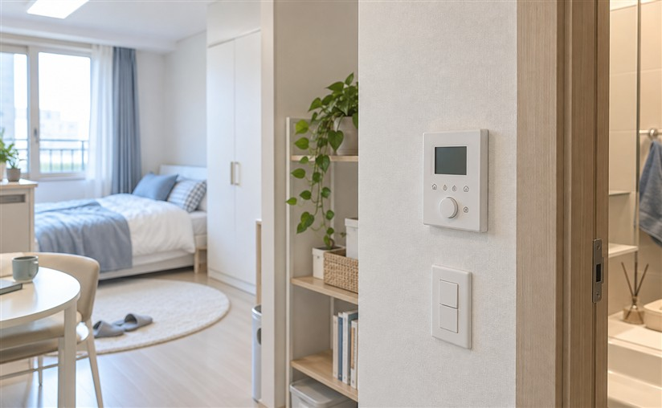 |
| G08 | 보일러 부재 관리 | 영상 생략 | 없음 |  |

## 화장실 (3개)

| 번호 | 문제 | 영상 | 준비물 · 쿠팡 검색 | 이미지 |
|---|---|---|---|---|
| G12 | 변기 물샘 소음 | [영상 보기](https://www.youtube.com/watch?v=6u_8ejz1mDA) | [식용 색소](https://www.coupang.com/np/search?q=%EC%8B%9D%EC%9A%A9+%EC%83%89%EC%86%8C) | 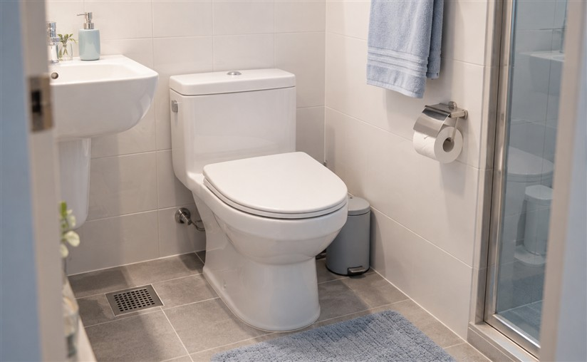 |
| G25 | 샤워기 교체 준비 | [영상 보기](https://www.youtube.com/watch?v=gHs2HcQaqgQ) | [투명 지퍼백](https://www.coupang.com/np/search?q=%ED%88%AC%EB%AA%85+%EC%A7%80%ED%8D%BC%EB%B0%B1) [줄자](https://www.coupang.com/np/search?q=%EC%A4%84%EC%9E%90) | 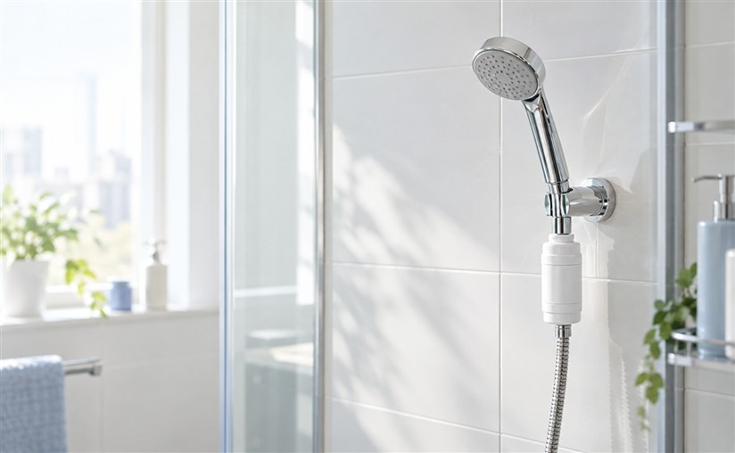 |
| G42 | 변기 급수 지연 | 영상 생략 | [두루마리 휴지](https://www.coupang.com/np/search?q=%EB%91%90%EB%A3%A8%EB%A7%88%EB%A6%AC+%ED%9C%B4%EC%A7%80) |  |

## 냉장고 (1개)

| 번호 | 문제 | 영상 | 준비물 · 쿠팡 검색 | 이미지 |
|---|---|---|---|---|
| G55 | 정전 후 식품 점검 | 영상 생략 | [냉장고용 온도계](https://www.coupang.com/np/search?q=%EB%83%89%EC%9E%A5%EA%B3%A0%EC%9A%A9+%EC%98%A8%EB%8F%84%EA%B3%84) [식품용 냉동 지퍼백](https://www.coupang.com/np/search?q=%EC%8B%9D%ED%92%88%EC%9A%A9+%EB%83%89%EB%8F%99+%EC%A7%80%ED%8D%BC%EB%B0%B1) | 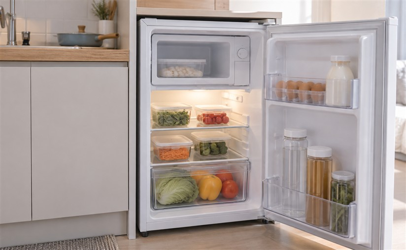 |

## 수도·수질 (3개)

| 번호 | 문제 | 영상 | 준비물 · 쿠팡 검색 | 이미지 |
|---|---|---|---|---|
| G11 | 수도 사용량 증가 | 영상 생략 | 없음 | 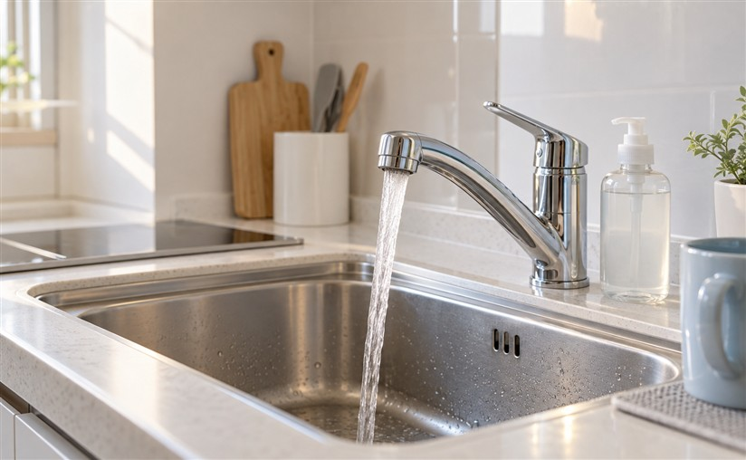 |
| G40 | 싱크대 막힘 | [영상 보기](https://www.youtube.com/watch?v=oPblR6WMEZk) | [고무장갑](https://www.coupang.com/np/search?q=%EA%B3%A0%EB%AC%B4%EC%9E%A5%EA%B0%91) [비닐봉투](https://www.coupang.com/np/search?q=%EB%B9%84%EB%8B%90%EB%B4%89%ED%88%AC) [싱크대용 압축기](https://www.coupang.com/np/search?q=%EC%8B%B1%ED%81%AC%EB%8C%80%EC%9A%A9+%EC%95%95%EC%B6%95%EA%B8%B0) |  |
| G58 | 싱크대 누수 | 영상 생략 | [낮은 물받이 대야](https://www.coupang.com/np/search?q=%EB%82%AE%EC%9D%80+%EB%AC%BC%EB%B0%9B%EC%9D%B4+%EB%8C%80%EC%95%BC) [흡수용 수건](https://www.coupang.com/np/search?q=%ED%9D%A1%EC%88%98%EC%9A%A9+%EC%88%98%EA%B1%B4) [두루마리 휴지](https://www.coupang.com/np/search?q=%EB%91%90%EB%A3%A8%EB%A7%88%EB%A6%AC+%ED%9C%B4%EC%A7%80) |  |

## 전기·조명 (2개)

| 번호 | 문제 | 영상 | 준비물 · 쿠팡 검색 | 이미지 |
|---|---|---|---|---|
| G26 | 멀티탭 발열 | 영상 생략 | 없음 | 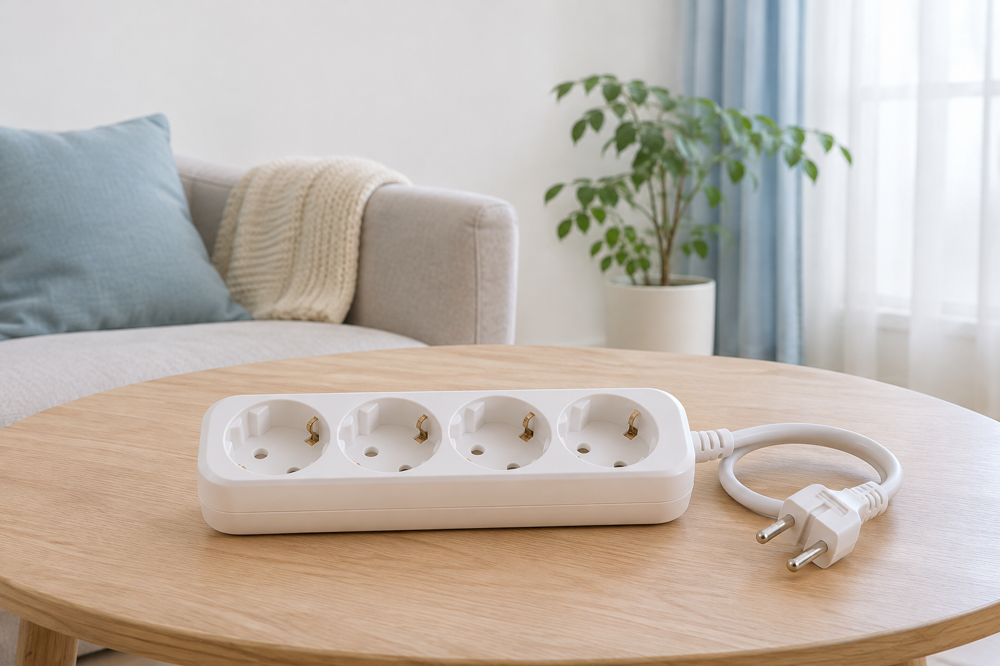 |
| G27 | 센서등 오작동 | 영상 생략 | 없음 | 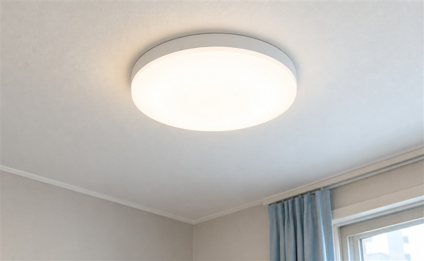 |

## 세탁기 (5개)

| 번호 | 문제 | 영상 | 준비물 · 쿠팡 검색 | 이미지 |
|---|---|---|---|---|
| G13 | 세탁기 배수필터 | [영상 보기](https://www.youtube.com/watch?v=nzbShJFcfws) | [낮은 물받이 대야](https://www.coupang.com/np/search?q=%EB%82%AE%EC%9D%80+%EB%AC%BC%EB%B0%9B%EC%9D%B4+%EB%8C%80%EC%95%BC) [극세사 천](https://www.coupang.com/np/search?q=%EA%B7%B9%EC%84%B8%EC%82%AC+%EC%B2%9C) [고무장갑](https://www.coupang.com/np/search?q=%EA%B3%A0%EB%AC%B4%EC%9E%A5%EA%B0%91) | 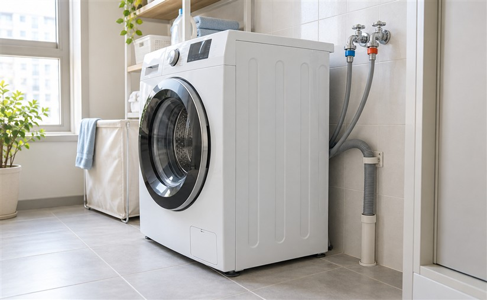 |
| G14 | 세탁조 냄새 | [영상 보기](https://www.youtube.com/watch?v=qXJ7qi7rpAk) | [세탁조 클리너](https://www.coupang.com/np/search?q=%EC%84%B8%ED%83%81%EC%A1%B0+%ED%81%B4%EB%A6%AC%EB%84%88) [계량컵](https://www.coupang.com/np/search?q=%EA%B3%84%EB%9F%89%EC%BB%B5) | 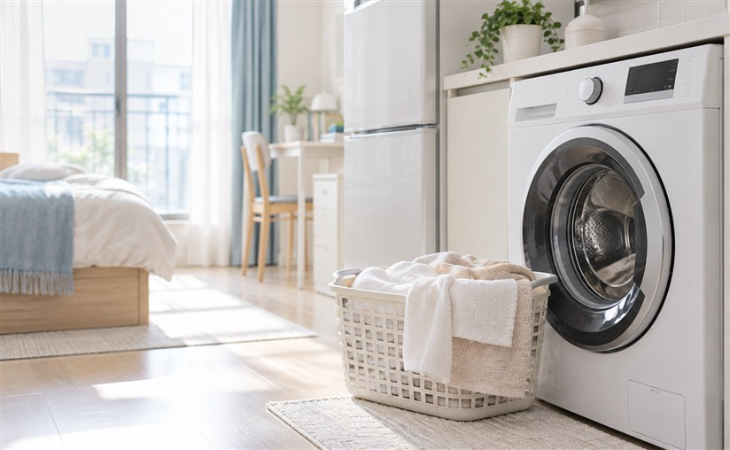 |
| G15 | 세제·유연제 잔류 | [영상 보기](https://www.youtube.com/watch?v=bEjJIB66teg) | [계량컵](https://www.coupang.com/np/search?q=%EA%B3%84%EB%9F%89%EC%BB%B5) [부드러운 청소솔](https://www.coupang.com/np/search?q=%EB%B6%80%EB%93%9C%EB%9F%AC%EC%9A%B4+%EC%B2%AD%EC%86%8C%EC%86%94) |  |
| G16 | 세탁기 tCL 표시 | [영상 보기](https://www.youtube.com/watch?v=qXJ7qi7rpAk) | [세탁조 클리너](https://www.coupang.com/np/search?q=%EC%84%B8%ED%83%81%EC%A1%B0+%ED%81%B4%EB%A6%AC%EB%84%88) |  |
| G68 | 세탁기 문 잠김 | 영상 생략 | 없음 | 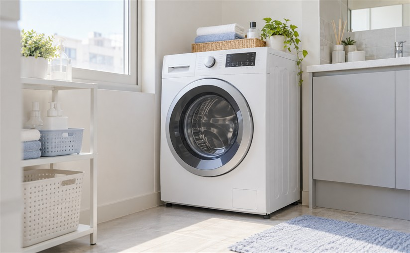 |

## 해충 (5개)

| 번호 | 문제 | 영상 | 준비물 · 쿠팡 검색 | 이미지 |
|---|---|---|---|---|
| G33 | 모기 유입 | 영상 생략 | [고무장갑](https://www.coupang.com/np/search?q=%EA%B3%A0%EB%AC%B4%EC%9E%A5%EA%B0%91) [부드러운 청소솔](https://www.coupang.com/np/search?q=%EB%B6%80%EB%93%9C%EB%9F%AC%EC%9A%B4+%EC%B2%AD%EC%86%8C%EC%86%94) | 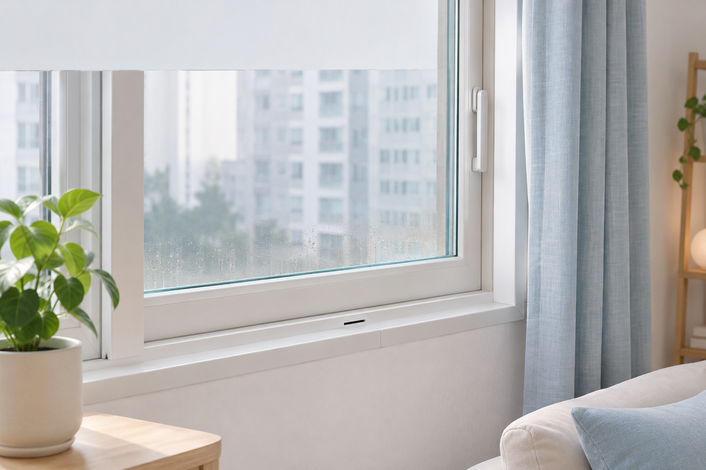 |
| G34 | 쥐며느리 유입 | 영상 생략 | [빗자루 쓰레받기 세트](https://www.coupang.com/np/search?q=%EB%B9%97%EC%9E%90%EB%A3%A8+%EC%93%B0%EB%A0%88%EB%B0%9B%EA%B8%B0+%EC%84%B8%ED%8A%B8) [디지털 온습도계](https://www.coupang.com/np/search?q=%EB%94%94%EC%A7%80%ED%84%B8+%EC%98%A8%EC%8A%B5%EB%8F%84%EA%B3%84) | 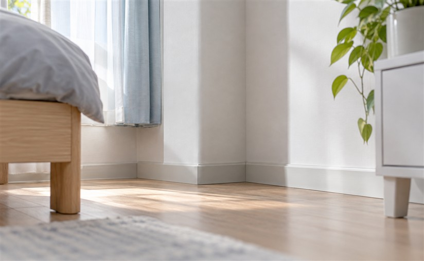 |
| G35 | 바퀴벌레 재발 | 영상 생략 | [식품 밀폐용기](https://www.coupang.com/np/search?q=%EC%8B%9D%ED%92%88+%EB%B0%80%ED%8F%90%EC%9A%A9%EA%B8%B0) [뚜껑 있는 쓰레기통](https://www.coupang.com/np/search?q=%EB%9A%9C%EA%BB%91+%EC%9E%88%EB%8A%94+%EC%93%B0%EB%A0%88%EA%B8%B0%ED%86%B5) [극세사 천](https://www.coupang.com/np/search?q=%EA%B7%B9%EC%84%B8%EC%82%AC+%EC%B2%9C) |  |
| G36 | 살충제 사용 점검 | 영상 생략 | [살충제](https://www.coupang.com/np/search?q=%EC%82%B4%EC%B6%A9%EC%A0%9C) [고무장갑](https://www.coupang.com/np/search?q=%EA%B3%A0%EB%AC%B4%EC%9E%A5%EA%B0%91) |  |
| G51 | 빈대 의심 | 영상 생략 | [투명 지퍼백](https://www.coupang.com/np/search?q=%ED%88%AC%EB%AA%85+%EC%A7%80%ED%8D%BC%EB%B0%B1) [투명 보관용기](https://www.coupang.com/np/search?q=%ED%88%AC%EB%AA%85+%EB%B3%B4%EA%B4%80%EC%9A%A9%EA%B8%B0) | 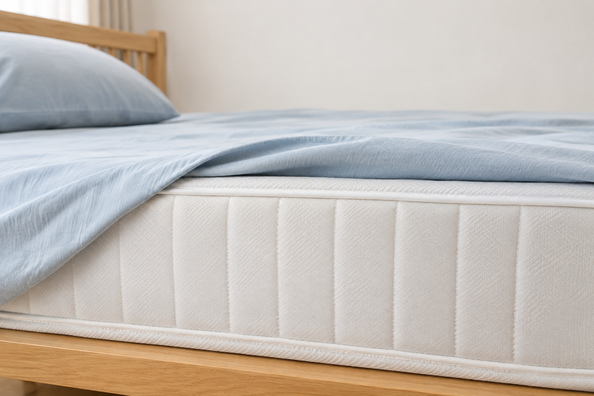 |

## 곰팡이 (2개)

| 번호 | 문제 | 영상 | 준비물 · 쿠팡 검색 | 이미지 |
|---|---|---|---|---|
| G05 | 옷장 습기 | [영상 보기](https://www.youtube.com/watch?v=RcYcc7yZ3n4) | [디지털 온습도계](https://www.coupang.com/np/search?q=%EB%94%94%EC%A7%80%ED%84%B8+%EC%98%A8%EC%8A%B5%EB%8F%84%EA%B3%84) [제습기](https://www.coupang.com/np/search?q=%EC%A0%9C%EC%8A%B5%EA%B8%B0) | 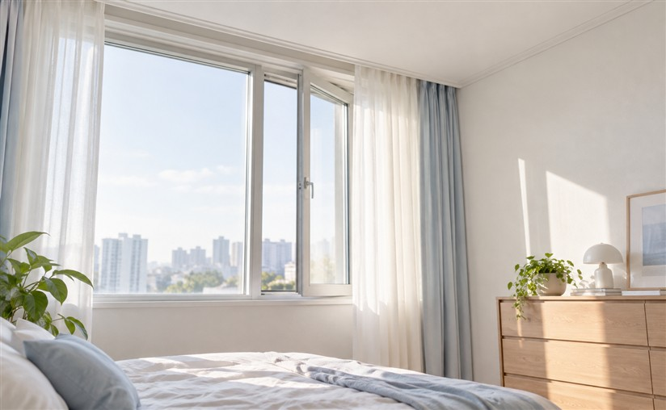 |
| G06 | 창문 결로 | [영상 보기](https://www.youtube.com/watch?v=tKPQe9fjYT4) | [극세사 천](https://www.coupang.com/np/search?q=%EA%B7%B9%EC%84%B8%EC%82%AC+%EC%B2%9C) [디지털 온습도계](https://www.coupang.com/np/search?q=%EB%94%94%EC%A7%80%ED%84%B8+%EC%98%A8%EC%8A%B5%EB%8F%84%EA%B3%84) |  |

## 검색 전용 (39개)

| 번호 | 문제 | 영상 | 준비물 · 쿠팡 검색 | 이미지 |
|---|---|---|---|---|
| G01 | 가스 냄새 | 영상 생략 | 없음 | 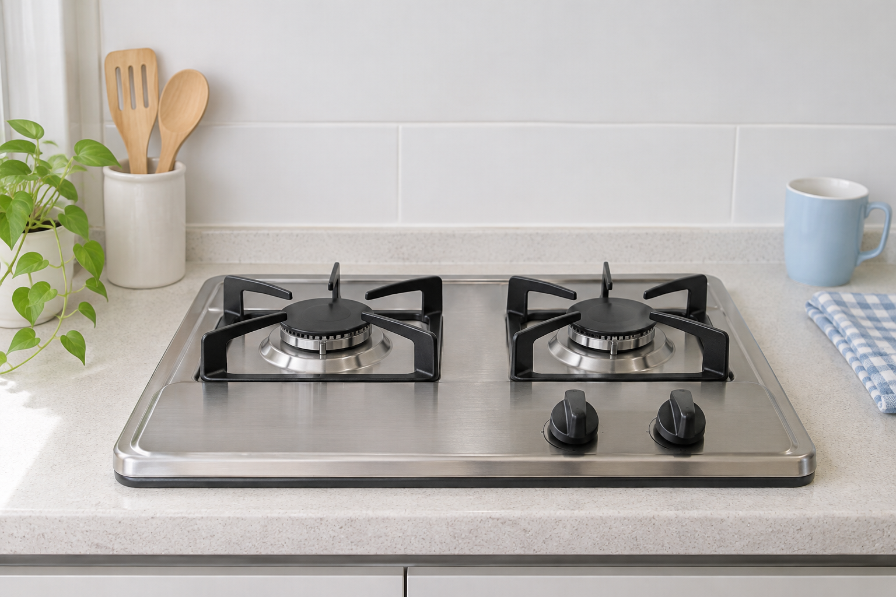 |
| G63 | 일산화탄소 경보 | 영상 생략 | 없음 | 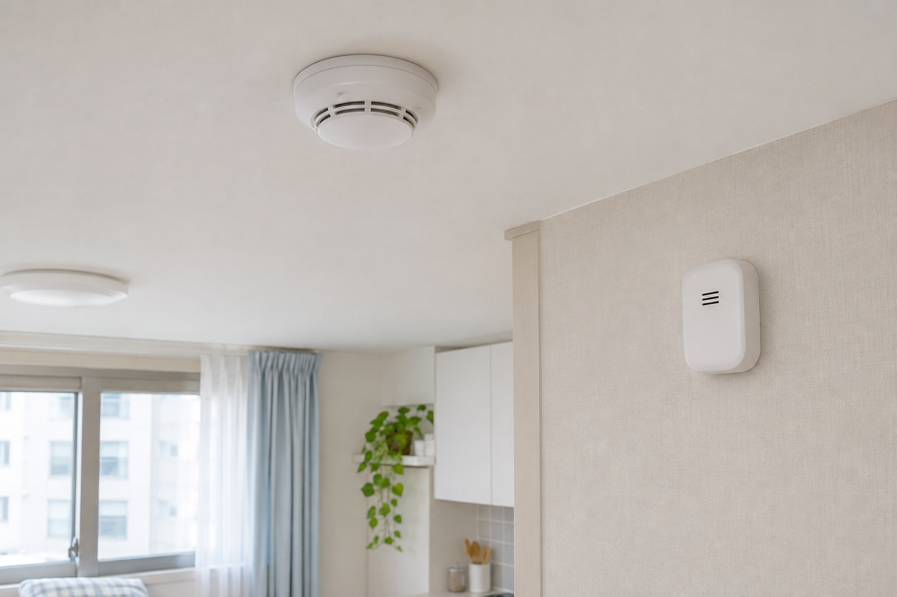 |
| G64 | 경보기 알림음 | [영상 보기](https://www.youtube.com/watch?v=5FaAZ_1GHFU) | 없음 |  |
| G09 | 전기매트 점검 | 영상 생략 | 없음 | 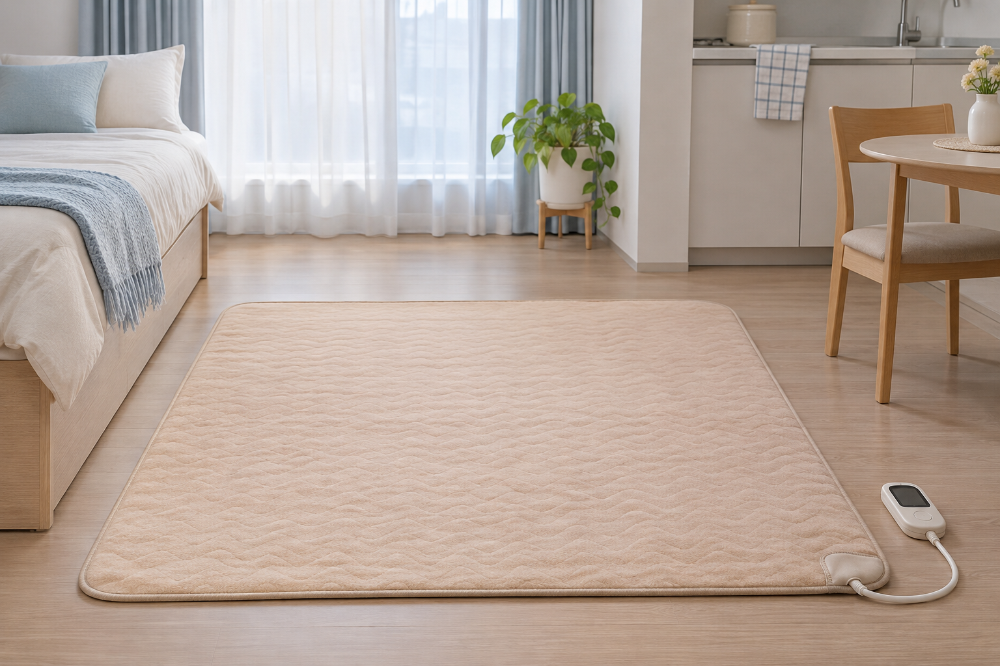 |
| G38 | 창문 외풍 | [영상 보기](https://www.youtube.com/watch?v=A6nO3h0bfbo) | [제거형 문풍지](https://www.coupang.com/np/search?q=%EC%A0%9C%EA%B1%B0%ED%98%95+%EB%AC%B8%ED%92%8D%EC%A7%80) [줄자](https://www.coupang.com/np/search?q=%EC%A4%84%EC%9E%90) |  |
| G61 | 도어락 방전 | [영상 보기](https://www.youtube.com/watch?v=usxlFP7e8a8) | [9V 알카라인 건전지](https://www.coupang.com/np/search?q=9V+%EC%95%8C%EC%B9%B4%EB%9D%BC%EC%9D%B8+%EA%B1%B4%EC%A0%84%EC%A7%80) [AA LR6 알카라인 건전지](https://www.coupang.com/np/search?q=AA+LR6+%EC%95%8C%EC%B9%B4%EB%9D%BC%EC%9D%B8+%EA%B1%B4%EC%A0%84%EC%A7%80) | 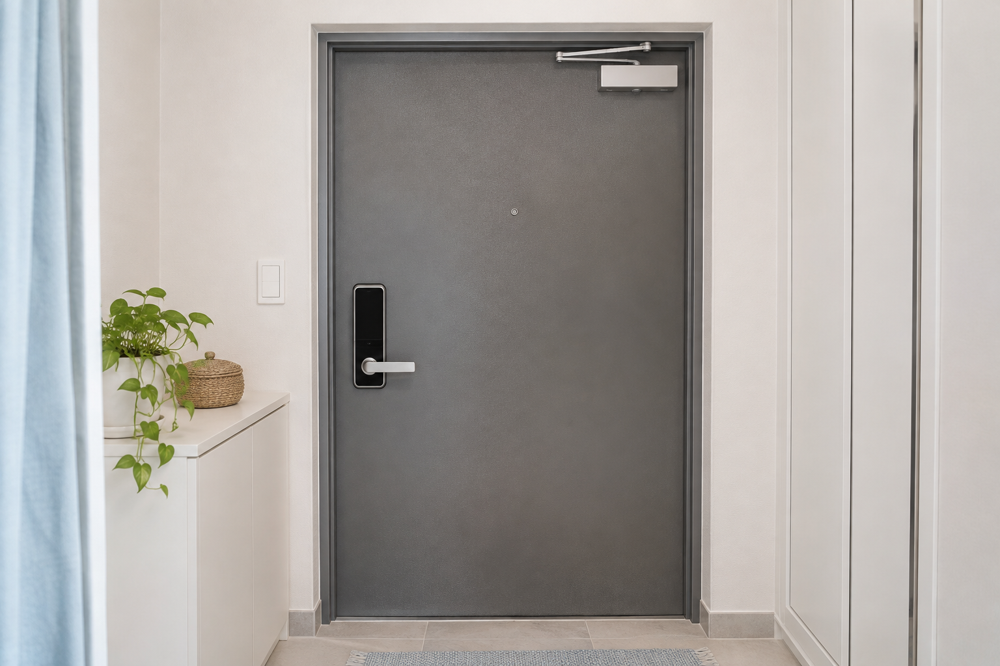 |
| G28 | 세정제 안전 사용 | [영상 보기](https://www.youtube.com/watch?v=xQL8GMAezJQ) | [고무장갑](https://www.coupang.com/np/search?q=%EA%B3%A0%EB%AC%B4%EC%9E%A5%EA%B0%91) [계량컵](https://www.coupang.com/np/search?q=%EA%B3%84%EB%9F%89%EC%BB%B5) [극세사 천](https://www.coupang.com/np/search?q=%EA%B7%B9%EC%84%B8%EC%82%AC+%EC%B2%9C) [표면 세정제](https://www.coupang.com/np/search?q=%ED%91%9C%EB%A9%B4+%EC%84%B8%EC%A0%95%EC%A0%9C) | 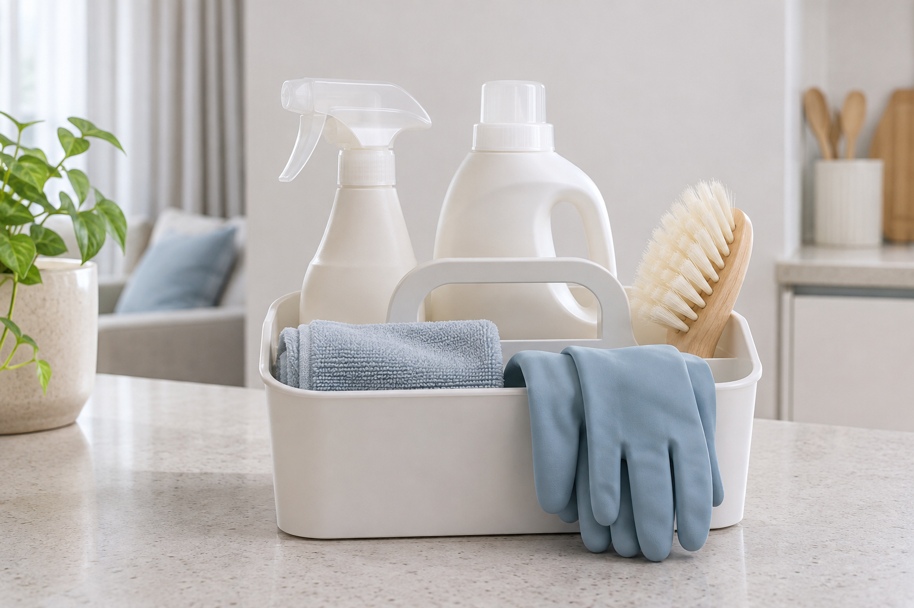 |
| G29 | 음식물통 냄새 | [영상 보기](https://www.youtube.com/watch?v=FR3VLHJJCIE) | [뚜껑 있는 음식물 쓰레기통](https://www.coupang.com/np/search?q=%EB%9A%9C%EA%BB%91+%EC%9E%88%EB%8A%94+%EC%9D%8C%EC%8B%9D%EB%AC%BC+%EC%93%B0%EB%A0%88%EA%B8%B0%ED%86%B5) [고무장갑](https://www.coupang.com/np/search?q=%EA%B3%A0%EB%AC%B4%EC%9E%A5%EA%B0%91) [부드러운 청소솔](https://www.coupang.com/np/search?q=%EB%B6%80%EB%93%9C%EB%9F%AC%EC%9A%B4+%EC%B2%AD%EC%86%8C%EC%86%94) | 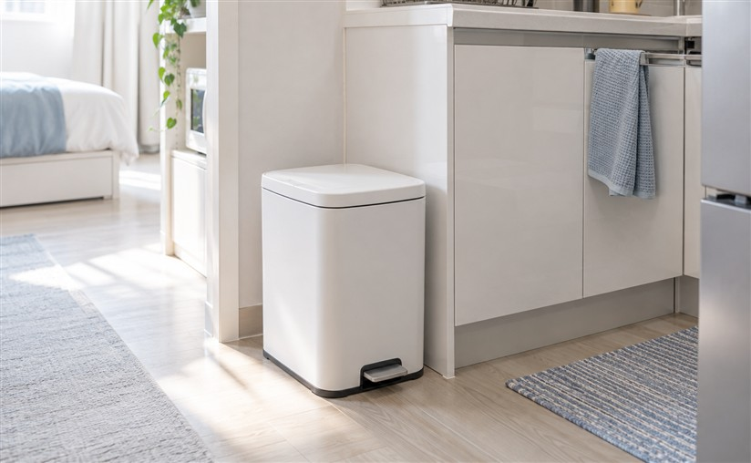 |
| G31 | 소형가전 폐기 | [영상 보기](https://www.youtube.com/watch?v=HdU2Bij6k5E) | [절연테이프](https://www.coupang.com/np/search?q=%EC%A0%88%EC%97%B0%ED%85%8C%EC%9D%B4%ED%94%84) | 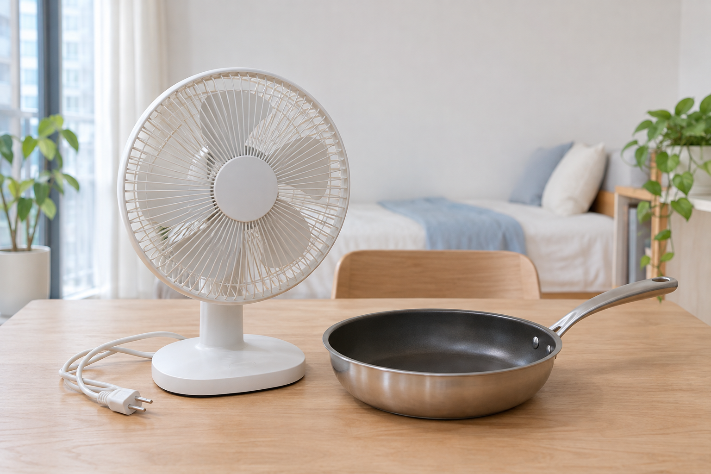 |
| G32 | 프라이팬 폐기 | [영상 보기](https://www.youtube.com/watch?v=9UvQWT28N-I) | [고무장갑](https://www.coupang.com/np/search?q=%EA%B3%A0%EB%AC%B4%EC%9E%A5%EA%B0%91) [부드러운 스펀지](https://www.coupang.com/np/search?q=%EB%B6%80%EB%93%9C%EB%9F%AC%EC%9A%B4+%EC%8A%A4%ED%8E%80%EC%A7%80) |  |
| G49 | 집안 청소 순서 | [영상 보기](https://www.youtube.com/watch?v=O4bDMEw2V_k) | [비닐봉투](https://www.coupang.com/np/search?q=%EB%B9%84%EB%8B%90%EB%B4%89%ED%88%AC) [극세사 천](https://www.coupang.com/np/search?q=%EA%B7%B9%EC%84%B8%EC%82%AC+%EC%B2%9C) [고무장갑](https://www.coupang.com/np/search?q=%EA%B3%A0%EB%AC%B4%EC%9E%A5%EA%B0%91) [표면 세정제](https://www.coupang.com/np/search?q=%ED%91%9C%EB%A9%B4+%EC%84%B8%EC%A0%95%EC%A0%9C) |  |
| G81 | 공사 후 분진 | 영상 생략 | [극세사 천](https://www.coupang.com/np/search?q=%EA%B7%B9%EC%84%B8%EC%82%AC+%EC%B2%9C) [청소용 밀대](https://www.coupang.com/np/search?q=%EC%B2%AD%EC%86%8C%EC%9A%A9+%EB%B0%80%EB%8C%80) [고무장갑](https://www.coupang.com/np/search?q=%EA%B3%A0%EB%AC%B4%EC%9E%A5%EA%B0%91) [비닐봉투](https://www.coupang.com/np/search?q=%EB%B9%84%EB%8B%90%EB%B4%89%ED%88%AC) | 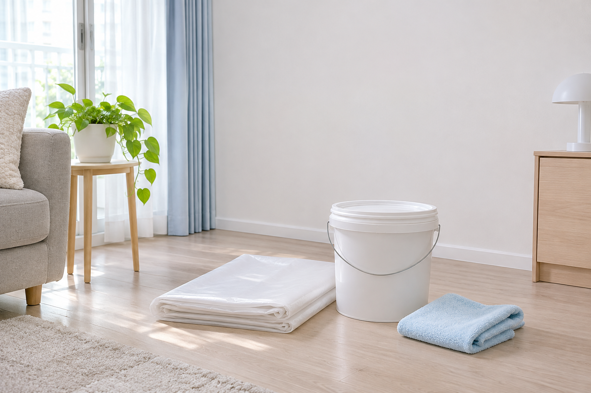 |
| G60 | 천장·벽 누수 | 영상 생략 | [낮은 물받이 대야](https://www.coupang.com/np/search?q=%EB%82%AE%EC%9D%80+%EB%AC%BC%EB%B0%9B%EC%9D%B4+%EB%8C%80%EC%95%BC) [흡수용 수건](https://www.coupang.com/np/search?q=%ED%9D%A1%EC%88%98%EC%9A%A9+%EC%88%98%EA%B1%B4) | 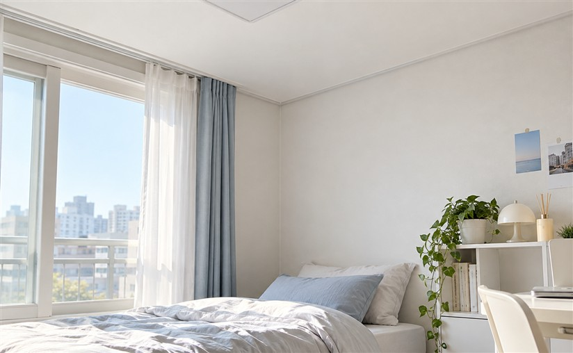 |
| G76 | 환풍구 냄새 유입 | 영상 생략 | 없음 | 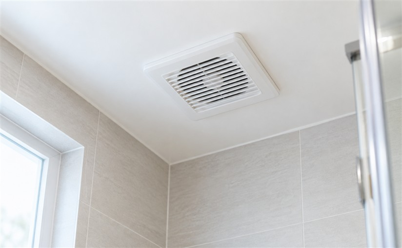 |
| G77 | 벽지 얼룩·손상 | 영상 생략 | [극세사 천](https://www.coupang.com/np/search?q=%EA%B7%B9%EC%84%B8%EC%82%AC+%EC%B2%9C) |  |
| G80 | 새집·가구 냄새 | 영상 생략 | [디지털 온습도계](https://www.coupang.com/np/search?q=%EB%94%94%EC%A7%80%ED%84%B8+%EC%98%A8%EC%8A%B5%EB%8F%84%EA%B3%84) |  |
| G17 | 건조기 냄새 | [영상 보기](https://www.youtube.com/watch?v=RZPhHJF6IMI) | [부드러운 청소솔](https://www.coupang.com/np/search?q=%EB%B6%80%EB%93%9C%EB%9F%AC%EC%9A%B4+%EC%B2%AD%EC%86%8C%EC%86%94) | 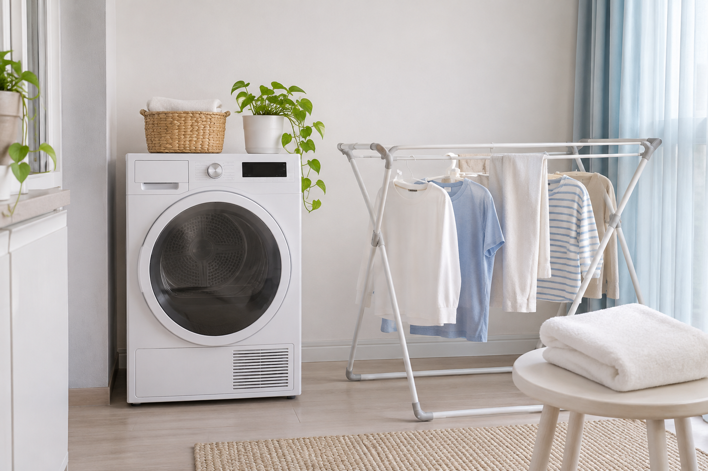 |
| G20 | 빨래 건조 보조 | [영상 보기](https://www.youtube.com/watch?v=ouwbQMlEAKA) | [접이식 건조대](https://www.coupang.com/np/search?q=%EC%A0%91%EC%9D%B4%EC%8B%9D+%EA%B1%B4%EC%A1%B0%EB%8C%80) [선풍기](https://www.coupang.com/np/search?q=%EC%84%A0%ED%92%8D%EA%B8%B0) |  |
| G21 | 제습기 관리 | 영상 생략 | [디지털 온습도계](https://www.coupang.com/np/search?q=%EB%94%94%EC%A7%80%ED%84%B8+%EC%98%A8%EC%8A%B5%EB%8F%84%EA%B3%84) [제습기](https://www.coupang.com/np/search?q=%EC%A0%9C%EC%8A%B5%EA%B8%B0) | 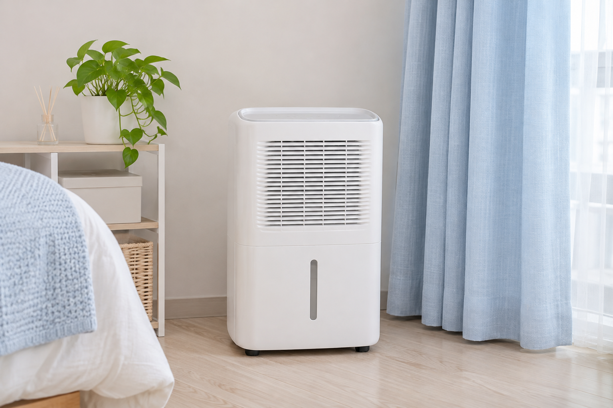 |
| G22 | 건조기 설치 점검 | 영상 생략 | [줄자](https://www.coupang.com/np/search?q=%EC%A4%84%EC%9E%90) |  |
| G78 | 세탁물 구김 | [영상 보기](https://www.youtube.com/watch?v=mW_JBkWfidc) | [빨래 바구니](https://www.coupang.com/np/search?q=%EB%B9%A8%EB%9E%98+%EB%B0%94%EA%B5%AC%EB%8B%88) [옷걸이](https://www.coupang.com/np/search?q=%EC%98%B7%EA%B1%B8%EC%9D%B4) [접이식 건조대](https://www.coupang.com/np/search?q=%EC%A0%91%EC%9D%B4%EC%8B%9D+%EA%B1%B4%EC%A1%B0%EB%8C%80) |  |
| G02 | 에어컨 소음 | 영상 생략 | 없음 | 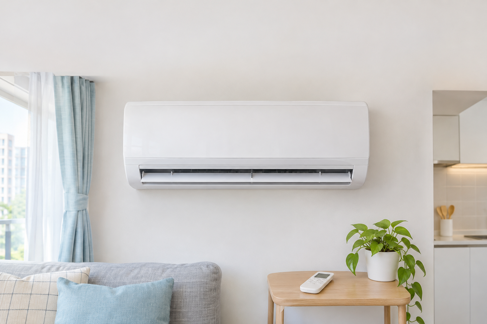 |
| G41 | 로봇청소기 필터 | [영상 보기](https://www.youtube.com/watch?v=nVGWwB2hXr8) | [극세사 천](https://www.coupang.com/np/search?q=%EA%B7%B9%EC%84%B8%EC%82%AC+%EC%B2%9C) | 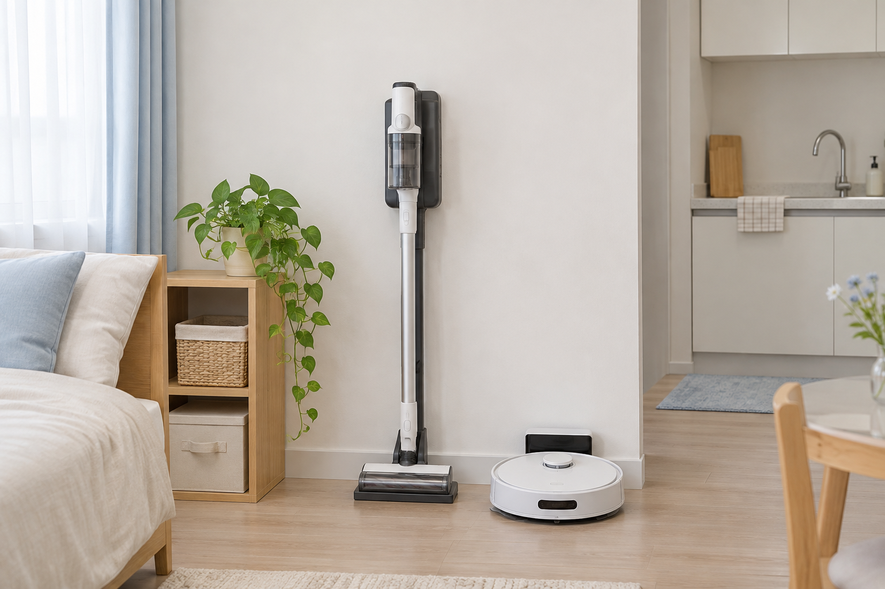 |
| G43 | 에어컨 필터 청소 | [영상 보기](https://www.youtube.com/watch?v=97IGJGC77iE) | [부드러운 청소솔](https://www.coupang.com/np/search?q=%EB%B6%80%EB%93%9C%EB%9F%AC%EC%9A%B4+%EC%B2%AD%EC%86%8C%EC%86%94) |  |
| G46 | 전자레인지 청소 | [영상 보기](https://www.youtube.com/watch?v=FQzH9fXMi1c) | [극세사 천](https://www.coupang.com/np/search?q=%EA%B7%B9%EC%84%B8%EC%82%AC+%EC%B2%9C) [부드러운 스펀지](https://www.coupang.com/np/search?q=%EB%B6%80%EB%93%9C%EB%9F%AC%EC%9A%B4+%EC%8A%A4%ED%8E%80%EC%A7%80) [중성 주방세제](https://www.coupang.com/np/search?q=%EC%A4%91%EC%84%B1+%EC%A3%BC%EB%B0%A9%EC%84%B8%EC%A0%9C) [고무장갑](https://www.coupang.com/np/search?q=%EA%B3%A0%EB%AC%B4%EC%9E%A5%EA%B0%91) | 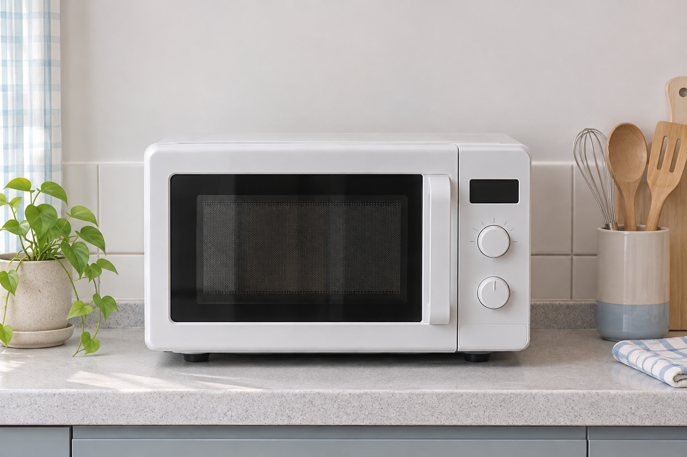 |
| G47 | 가습기 청소 | [영상 보기](https://www.youtube.com/watch?v=jC47yvTfQAA) | [부드러운 청소솔](https://www.coupang.com/np/search?q=%EB%B6%80%EB%93%9C%EB%9F%AC%EC%9A%B4+%EC%B2%AD%EC%86%8C%EC%86%94) [디지털 온습도계](https://www.coupang.com/np/search?q=%EB%94%94%EC%A7%80%ED%84%B8+%EC%98%A8%EC%8A%B5%EB%8F%84%EA%B3%84) | 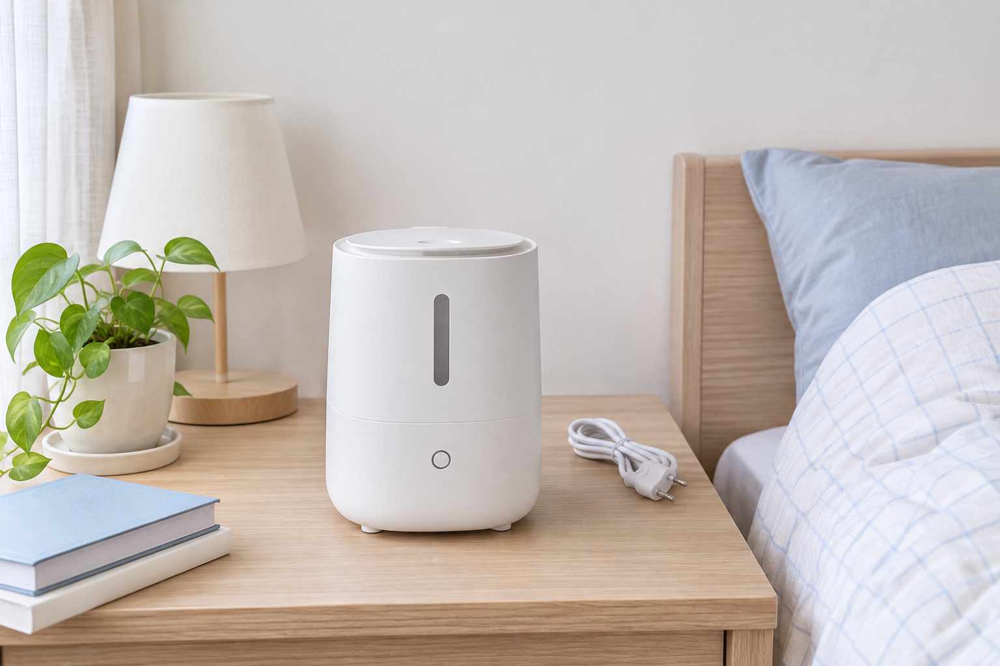 |
| G52 | 전기주전자 물때 | [영상 보기](https://www.youtube.com/watch?v=m9d3ukVz4rs) | [전기주전자용 석회질 제거제](https://www.coupang.com/np/search?q=%EC%A0%84%EA%B8%B0%EC%A3%BC%EC%A0%84%EC%9E%90%EC%9A%A9+%EC%84%9D%ED%9A%8C%EC%A7%88+%EC%A0%9C%EA%B1%B0%EC%A0%9C) [고무장갑](https://www.coupang.com/np/search?q=%EA%B3%A0%EB%AC%B4%EC%9E%A5%EA%B0%91) | 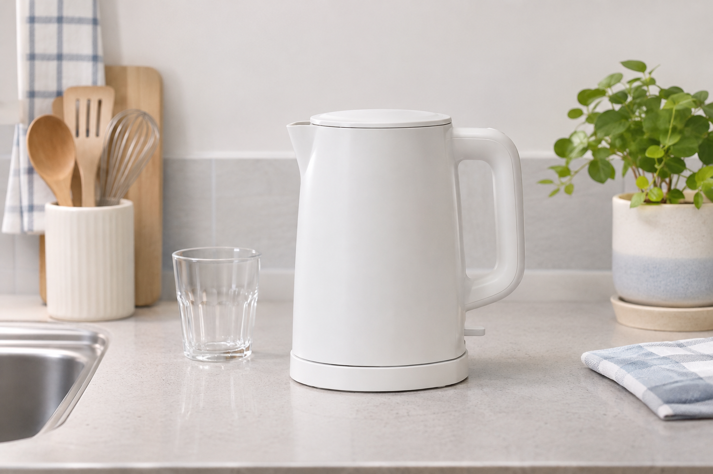 |
| G53 | 식기세척기 냄새 | [영상 보기](https://www.youtube.com/watch?v=V3-DVomt2jw) | [고무장갑](https://www.coupang.com/np/search?q=%EA%B3%A0%EB%AC%B4%EC%9E%A5%EA%B0%91) [부드러운 청소솔](https://www.coupang.com/np/search?q=%EB%B6%80%EB%93%9C%EB%9F%AC%EC%9A%B4+%EC%B2%AD%EC%86%8C%EC%86%94) [비닐봉투](https://www.coupang.com/np/search?q=%EB%B9%84%EB%8B%90%EB%B4%89%ED%88%AC) | 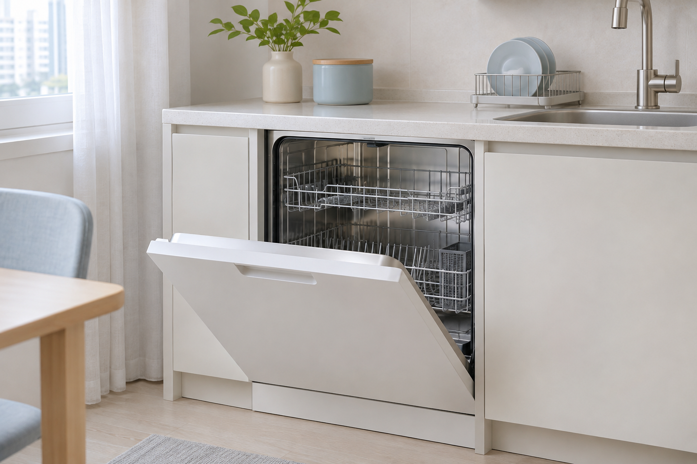 |
| G54 | 인덕션 용기 오류 | 영상 생략 | [IH용 냄비](https://www.coupang.com/np/search?q=IH%EC%9A%A9+%EB%83%84%EB%B9%84) [극세사 천](https://www.coupang.com/np/search?q=%EA%B7%B9%EC%84%B8%EC%82%AC+%EC%B2%9C) | 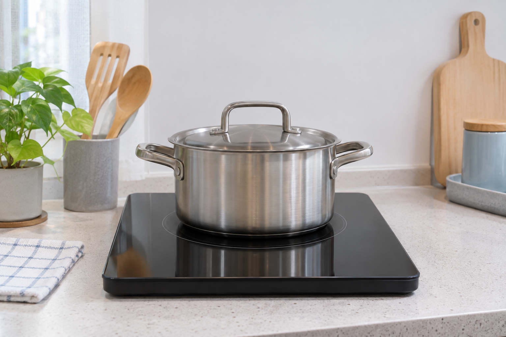 |
| G65 | 가스레인지 점화 불량 | 영상 생략 | [건전지](https://www.coupang.com/np/search?q=%EA%B1%B4%EC%A0%84%EC%A7%80) [극세사 천](https://www.coupang.com/np/search?q=%EA%B7%B9%EC%84%B8%EC%82%AC+%EC%B2%9C) |  |
| G66 | 에어컨 물샘 | 영상 생략 | [흡수용 수건](https://www.coupang.com/np/search?q=%ED%9D%A1%EC%88%98%EC%9A%A9+%EC%88%98%EA%B1%B4) [낮은 물받이 대야](https://www.coupang.com/np/search?q=%EB%82%AE%EC%9D%80+%EB%AC%BC%EB%B0%9B%EC%9D%B4+%EB%8C%80%EC%95%BC) |  |
| G67 | 에어컨 냉방 불량 | [영상 보기](https://www.youtube.com/watch?v=97IGJGC77iE) | [디지털 온습도계](https://www.coupang.com/np/search?q=%EB%94%94%EC%A7%80%ED%84%B8+%EC%98%A8%EC%8A%B5%EB%8F%84%EA%B3%84) |  |
| G71 | 에어컨 리모컨 불량 | [영상 보기](https://www.youtube.com/watch?v=3sRMw2Y-DWw) | [건전지](https://www.coupang.com/np/search?q=%EA%B1%B4%EC%A0%84%EC%A7%80) [극세사 천](https://www.coupang.com/np/search?q=%EA%B7%B9%EC%84%B8%EC%82%AC+%EC%B2%9C) |  |
| G72 | 청소기 흡입 저하 | 영상 생략 | [비닐봉투](https://www.coupang.com/np/search?q=%EB%B9%84%EB%8B%90%EB%B4%89%ED%88%AC) [극세사 천](https://www.coupang.com/np/search?q=%EA%B7%B9%EC%84%B8%EC%82%AC+%EC%B2%9C) |  |
| G73 | 공기청정기 필터 | [영상 보기](https://www.youtube.com/watch?v=znmzWnSiMr0) | [극세사 천](https://www.coupang.com/np/search?q=%EA%B7%B9%EC%84%B8%EC%82%AC+%EC%B2%9C) [부드러운 청소솔](https://www.coupang.com/np/search?q=%EB%B6%80%EB%93%9C%EB%9F%AC%EC%9A%B4+%EC%B2%AD%EC%86%8C%EC%86%94) [공기청정기 교체 필터](https://www.coupang.com/np/search?q=%EA%B3%B5%EA%B8%B0%EC%B2%AD%EC%A0%95%EA%B8%B0+%EA%B5%90%EC%B2%B4+%ED%95%84%ED%84%B0) | 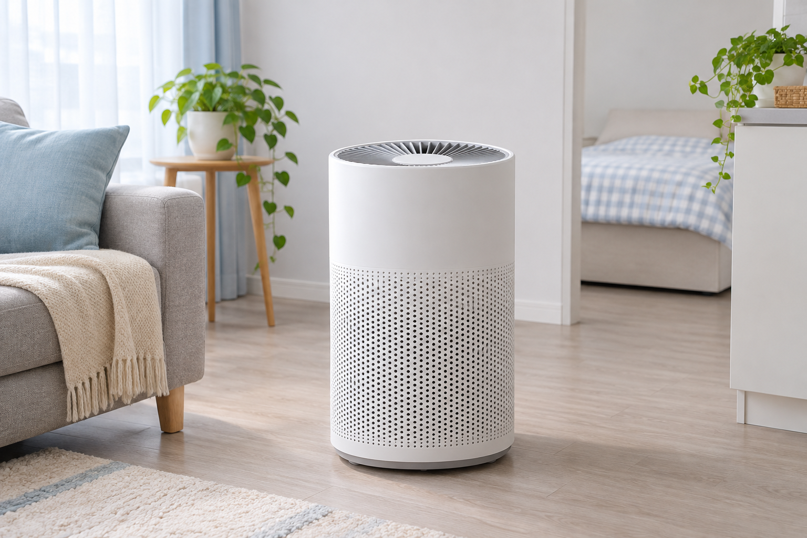 |
| G79 | 가스 화력 이상 | 영상 생략 | 없음 |  |
| G23 | 남은 음식 보관 | [영상 보기](https://www.youtube.com/watch?v=ZhYGyXBrHkg) | [식품 밀폐용기](https://www.coupang.com/np/search?q=%EC%8B%9D%ED%92%88+%EB%B0%80%ED%8F%90%EC%9A%A9%EA%B8%B0) [날짜 라벨 스티커](https://www.coupang.com/np/search?q=%EB%82%A0%EC%A7%9C+%EB%9D%BC%EB%B2%A8+%EC%8A%A4%ED%8B%B0%EC%BB%A4) [유성펜](https://www.coupang.com/np/search?q=%EC%9C%A0%EC%84%B1%ED%8E%9C) | 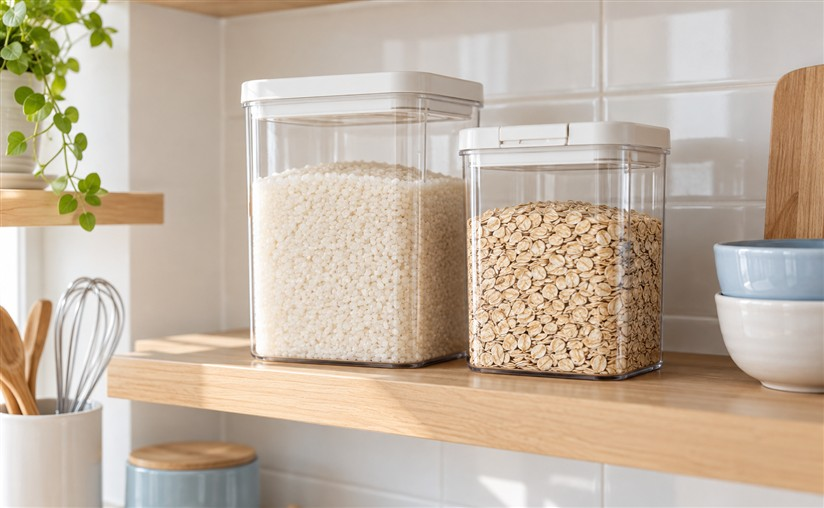 |
| G24 | 식빵 냉동 보관 | [영상 보기](https://www.youtube.com/watch?v=FIntdjsFxpQ) | [식품용 냉동 지퍼백](https://www.coupang.com/np/search?q=%EC%8B%9D%ED%92%88%EC%9A%A9+%EB%83%89%EB%8F%99+%EC%A7%80%ED%8D%BC%EB%B0%B1) [날짜 라벨 스티커](https://www.coupang.com/np/search?q=%EB%82%A0%EC%A7%9C+%EB%9D%BC%EB%B2%A8+%EC%8A%A4%ED%8B%B0%EC%BB%A4) [유성펜](https://www.coupang.com/np/search?q=%EC%9C%A0%EC%84%B1%ED%8E%9C) | 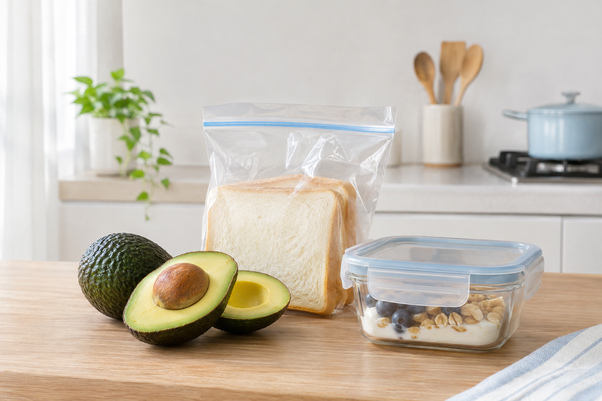 |
| G37 | 아보카도 보관 | [영상 보기](https://www.youtube.com/watch?v=-37_O-cyhyw) | [식품 밀폐용기](https://www.coupang.com/np/search?q=%EC%8B%9D%ED%92%88+%EB%B0%80%ED%8F%90%EC%9A%A9%EA%B8%B0) [날짜 라벨 스티커](https://www.coupang.com/np/search?q=%EB%82%A0%EC%A7%9C+%EB%9D%BC%EB%B2%A8+%EC%8A%A4%ED%8B%B0%EC%BB%A4) |  |

## 예슬이 작업 이어받기

GitHub main 전체를 내려받으면 데이터·사진·썸네일·분류·검색이 함께 연결됩니다. 기존 작업 폴더가 깨끗하면 `git switch main` 다음 `git pull --ff-only origin main`으로 받으세요. 작업 중인 변경이 있으면 먼저 별도 커밋하거나 다른 폴더에 새로 클론하세요. 이 폴더의 CSV만 기존 파일에 덮어쓰지 마세요.

추가 데이터는 `src/solutions/data/additional62/`, 사진 매핑은 `additional-photos.ts`, 홈 연결은 `home-routing.json`입니다. 준비물을 누르면 기존 공통 함수가 그 준비물 이름으로 쿠팡 검색을 엽니다. 홈에 없는 39개도 검색할 수 있습니다.

검증: 기존 53개 보존과 추가 62개, 31열, 4~8단계, 23개 홈 배치, 33개 영상 썸네일, 62개 사진 파일, 검색 회귀 테스트를 확인했습니다. TypeScript·카탈로그 빌드·기초 자산 검사도 통과했습니다. 신규 Android 기기 설치 검증은 포함하지 않습니다.

개인정보·정책: 새 SDK·서버·권한·분석 전송을 추가하지 않았습니다. 사진과 썸네일은 앱에 포함되며 영상·쿠팡은 사용자 클릭 시 기존 외부 링크 흐름을 사용합니다. 생성 사진은 설명용 이미지입니다. 영상 검토 기록은 `video-review.json`에 있으며 전체 프레임을 모두 검수했다는 의미는 아닙니다. 이 코드 병합은 별도의 스토어 배포 승인이나 영상 권리 확인을 대신하지 않습니다.
