주차별로 하위 내용 여닫을 수 있습니다.

 
<h2>5주차</h2>

### 맡은 역할
GitHub 저장소 세팅, 기술 타당성 검토, PRD 정리, 디자인 통합 논의 문서 작성 (※ 팀원과 공동으로 한 일은 삭제하거나 "(공동)"으로 표시)

### 한 일

**GitHub 세팅**
- 저장소 폴더 구조(docs, design, wireframes/이름, src, members/이름)를 Codex로 생성하고 PR로 올림
- git 사용자 이름·이메일을 확인해 커밋이 내 계정으로 연결되는 것을 확인
- main 브랜치 보호 규칙 때문에 PR 승인이 필요하다는 점을 파악하고 승인 절차를 팀에 공유
- main README 작성

**기술 타당성·PRD**
- 음성 트리거(iOS Siri 단축어/Android), 업체 정보 API, 문자 자동 발송 가능 범위 조사
- 조사 결과를 반영해 일정 조율을 빼고 해결 사례 도서관 + SOS 모드로 범위 확정에 참여
- Manyfast용 PRD 프롬프트 작성 및 PRD 초안 작성 (prd.md)

**디자인 통합 논의 문서**
- 팀원 3명이 각자 만든 디자인을 하나로 합치는 과정에서, 어떤 부분을 어떻게 합쳤는지와 논의사항을 문서로 정리해 작성 (design decision.md)

**와이어프레임·프로토타입**
- Figma(Figma Make)로 와이어프레임과 프로토타입 제작

### 결과 (커밋/PR/이슈 링크로 근거 남기기)
- PR #1 "폴더 구조 초기 세팅" (병합): https://github.com/sowon24-design/Howhouse/pull/1
- PR #5 "add prd.md & merge test" (병합): https://github.com/sowon24-design/Howhouse/pull/5
- PR #10 "add design decisions" (병합): https://github.com/sowon24-design/Howhouse/pull/10
- PR #11 "Delete docs/decisions" (병합): https://github.com/sowon24-design/Howhouse/pull/11
- PR #12 "add design decision.md" (병합): https://github.com/sowon24-design/Howhouse/pull/12
- PR #7 "wireframe-v1 pr" (리뷰 승인 없이 닫힘): https://github.com/sowon24-design/Howhouse/pull/7
- 브랜치별 내 커밋 목록:
- 1. main: https://github.com/sowon24-design/Howhouse/commits?author=xamxam33
  2. yeseul/design: https://github.com/sowon24-design/Howhouse/commits/yeseul/design
  3. yeseul/wireframe: https://github.com/sowon24-design/Howhouse/commits/yeseul/wireframe
  4. design-decision: https://github.com/sowon24-design/Howhouse/commits/design-decision
- 와이어프레임·프로토타입(Figma): https://www.figma.com/make/g3ZdCXZXOMinHk1c0Isjgf/Design-Wireframe-for-App?t=DFpoN6exd781E325-1
- 와이어프레임 (내 브랜치): https://github.com/sowon24-design/Howhouse/tree/yeseul/wireframe/wireframes/%ED%97%88%EC%98%88%EC%8A%AC
- 디자인 (내 브랜치): https://github.com/sowon24-design/Howhouse/tree/yeseul/design/design

 
<h2>6주차</h2>

### 맡은 역할
사용성 테스트 설계(공동 업무)·관찰, UT 분석, PRD 수정, 수정사항 문서 작성, 각종 파일 관리, 레포지토리 규칙 정리 (※ 팀원과 공동으로 한 일은 "(공동)"으로 표시)

### 한 일

**사용성 테스트 계획·진행**
- 사용성 테스트 계획 및 설계: 과업 시나리오(싱크대 아래 누수), 관찰 체크포인트(진입·수행·확인), 판정 기준(독립 성공·도움 후 성공·실패)
- 사용성 테스트 3회 진행 (관찰자)
- 사용성 테스트 템플릿 구글 독스 기록 (공동)
- 촬영 영상, 화면 녹화, 스크립트 등 UT 기록물을 드라이브와 GitHub에 정리

**사용성 테스트 분석**
- Claude를 활용한 UT 분석 프롬프트 설계: 반드시 지킬 규칙 6가지(알림 무시, 확인된 것만 쓰기, 확실도 표시, 발언 원문 유지, 사실·해석 분리, 시간 맞추기)와 출력 형식 5가지(화면 체류 타임라인, 사건 기록, 체크포인트 요약, 문제 후보, 확인 필요 목록)
- 손 촬영 영상, 화면 녹화, 음성 스크립트의 시간을 맞춰 참여자별 UT 기록 3건 작성 (UT_P01 · UT_P02 · UT_P03)
- 화면 녹화로 기존 기록의 [추정] 항목을 확인하고, 문제 정의를 수정해 기록을 완성
- UT를 어떤 자료와 프롬프트로 분석했는지 정리한 분석 과정 문서 작성

**UT 결과를 바탕으로 반영할 수정사항 논의 (공통 업무)**
- 팀원들과 논의를 통해 3번의 UT에서 공통적으로 발견된 문제 (ex. 긴급 모드를 사용하지 않음) 등을 정리
- 이를 바탕으로 PRD와 프로토타입에 수정할 내용을 논의 및 정리함

**PRD·프로토타입 수정**
- UT를 바탕으로 PRD 및 프로토타입 수정사항 6가지 도출 (공동): 긴급 모드 삭제, 해결 단계 용어 풀어 쓰기, 단계 카드 상세 이미지 삭제, 업체 찾기를 카카오맵 API 기준으로 통일, 메시지 전송 후 해결 사례 페이지로 복귀, 메시지 만들기 화면 구조 변경
- 업체 찾기 수정 방향을 정하기 위해 카카오맵 로컬 API의 제공 범위와 리뷰 수집 시 저작권 문제를 확인
- PRD 문서 수정: SOS 모드 관련 내용 삭제, 화면별 요구사항(문제 입력·사례 보기, 커뮤니티, 해결 단계 카드, 연락 메시지, 업체 찾기) 추가, 시나리오와 성공 지표 갱신
- 'w6_수정사항 기록' 파일에 수정 항목별 인사이트, UT 근거, 수정 이유, 수정 전·후를 문서화

**수정사항 문서화**
- UT 결과를 바탕으로 어떤 기능을 왜 고쳤는지 정리한 'w6_수정사항 기록' 문서 작성
- 수정 항목 6가지마다 핵심 인사이트 → UT 근거(참여자 발언·행동과 시점) → 수정 이유 → 수정 전·후 비교 순서로 정리
- 맨 위에 항목별 핵심 인사이트와 반영 위치(PRD 절, 프로토타입 화면)를 한눈에 보는 요약 표를 넣음
- 다음 UT에서 수정 효과를 확인할 재검증 기준을 항목별로 정리
- PRD에는 바뀐 기능만 남기고, 수정 근거는 이 문서로 분리해 PRD에서 링크로 연결

**저장소 운영**
- main README에 레포지토리 규칙 정리
- contribution 브랜치를 만들어 팀원 모두 매주 회고와 기여 기록을 작성할 수 있는 공간 신설
- /design 파일 내 디자인 제출물들을 codex로 주차별로 하위 폴더를 생성할 수 있도록 구조 변경

### 결과 (커밋/PR/이슈 링크로 근거 남기기)
- PR #14 - #16: https://github.com/sowon24-design/Howhouse/pulls?q=is%3Apr+state%3Aclosed
- 브랜치별 내 커밋 목록:
  1. main: https://github.com/sowon24-design/Howhouse/commits/main
  2. PRD: https://github.com/sowon24-design/Howhouse/commits/PRD
  3. W6-Usability-Test: https://github.com/sowon24-design/Howhouse/commits/W6-Usability-Test
  4. contribution: https://github.com/sowon24-design/Howhouse/commits/contribution
- UT 분석 기록 (내 브랜치 'yeseul/usability-test/Usability Test/허예슬_UT 분석 문서'): https://github.com/sowon24-design/Howhouse/tree/yeseul/usability-test/Usability%20Test/%ED%97%88%EC%98%88%EC%8A%AC_UT%20%EB%B6%84%EC%84%9D%20%EB%AC%B8%EC%84%9C
- 사용성 테스트 템플릿 기록 (구글 독스, 공동 업무): https://docs.google.com/document/d/1o35ro-qQkY2Kp1yOX1RPo5dv-gCnscj-b2y2-6C21IE/edit?tab=t.0
- UT 기록물 (드라이브): https://drive.google.com/drive/folders/1ah5hECdTXkZMfvGoauoKEmGQuanYvnLg?usp=drive_link

<h2>7주차</h2>

### 맡은 역할
개인 디자인 시안 제작, 발표 PPT의 공통 디자인 시스템·그리드 설정, IA 및 플로우차트 제작, 발표 PPT 제작(공동), 발표 준비 및 진행(공동)  
※ 팀원과 공동으로 한 일은 "(공동)"으로 표시

### 한 일

**개인 디자인 시안 제작**
- 개인 스케치를 바탕으로 Figma에서 디자인 시안 1·2 제작
- 화면별 레이아웃과 시각적 표현을 구체화하고 디자인 고도화
- 제작한 개인 시안을 팀 디자인 취합 및 발전의 바탕으로 활용

**발표 PPT 디자인 시스템·그리드 설정**
- 팀원들이 하나의 Figma 파일에서 작업할 때 발생할 수 있는 디자인 불일치를 줄이기 위해 공통 기준 마련
- PPT에 사용할 컬러·타이포그래피 시스템과 그리드 설정
- 모든 팀원이 일관된 색상·텍스트 위계·정렬 기준으로 슬라이드를 제작할 수 있도록 작업 환경 구성

**IA 및 플로우차트 제작**
- 사용성 테스트 결과와 수업 피드백을 반영한 7주차 최종 서비스 구조 정리
- 수정된 서비스 구조를 설명할 IA와 플로우차트 제작
- IA로 화면 간 정보 구조를 정리하고, 플로우차트로 주요 기능의 이용 순서와 화면 이동 흐름을 시각화

**발표 PPT 제작 (공동)**
- 1–7주차 활동 내용을 정리하여 발표 자료 초안 작성
- 발표 내용의 연결과 전달 순서를 고려해 PPT 전체 흐름 정리 (개인)
- 공통 디자인 시스템과 그리드를 바탕으로 슬라이드 디자인

**발표 준비 및 진행 (공동)**
- 팀원별 발표 파트를 나누고 담당 내용에 맞춰 발표 준비
- 각자 맡은 파트를 발표하며 프로젝트 진행 과정과 결과 공유

### 결과 (커밋/PR/이슈 링크로 근거 남기기)
- 개인 디자인 시안 1, 2 (내 브랜치): https://github.com/sowon24-design/Howhouse/tree/yeseul/design/design/w7%20design
- 팀 디자인 시안 1, 2: https://github.com/sowon24-design/Howhouse/tree/main/design/w7%20design
- 발표 PDF: https://www.figma.com/deck/2iw0u6sn1xJmAuFOetZ63E

<h2>8주차</h2>

### 맡은 역할
디자인 시안 2종을 바탕으로 디자인 고도화(공동), 추가 화면 디자인(공동), Codex를 활용한 Figma 디자인 초안 생성, 일부 반복 UI 요소 컴포넌트화  
(※ 팀원과 공동으로 한 일은 “(공동)”으로 표시)

### 한 일

**기존 디자인 시안 고도화 (공동)**
- 7주차에 제작한 디자인 시안 2종을 바탕으로 화면 구성과 시각적 표현을 수정
- 제작이 필요한 추가 화면에 기존 디자인을 적용하며 서비스 전반의 디자인 작업 진행

**Codex를 활용한 디자인 초안 생성**
- 기존 주요 화면 3개를 참고하도록 지정하고, 나머지 주요 화면의 초안을 Figma에 생성
- 화면별로 필요한 기능과 UI 구성을 설명하고, 기존 디자인 시스템과 공통 영역의 스타일을 유지하도록 요청
- 생성된 초안을 검토하고, 활용하기 어려운 부분은 기존 화면을 바탕으로 Figma에서 직접 재구성

**추가 화면 제작 및 수정 (공동으로 진행했으나 그 중 내가 제작한 부분을 중심으로 기록)**
- A~D 영역의 화면 디자인에 참여하고, 다음 화면을 중심으로 제작 및 수정 작업 진행
- A 영역: A02
- B 영역: B01-02, B03(UI 제작, 내용은 별개), B05-06
- C 영역: C02-03, C04 가공 작업, C05
- D 영역: D01-07 제작, D08-12 가공 작업, D14 제작

**반복 UI 요소 정리**
- 일부 반복 UI 요소를 컴포넌트화하여 재사용할 수 있도록 정리
- 화면 간 공통 요소를 수정하고 관리하기 위한 기반 마련

### 결과
- 공유용 피그마 링크: https://www.figma.com/design/iO6q06mMYF3TtmCSBBYfG6/%EB%94%94%EC%9E%90%EC%9D%B8-%EA%B3%B5%EC%9C%A0%EC%9A%A9?node-id=0-1&t=rkSEhrlArtiHcx3y-1
- w8 디자인 피그마 깃허브(사진) 경로: https://github.com/sowon24-design/Howhouse/tree/main/design/w8%20design

<h2>9주차</h2>

### 맡은 역할

이번 주에는 ①디자인 컴포넌트 관리 및 화면 수정, ②공통 컴포넌트 개발, ③담당 화면 구현, ④팀원 작업 통합 (전체 화면 연결), ⑤Android 시스템 연동, ⑥Android 시험 APK 실행까지 진행했다. Codex를 활용해 코드를 구현하고, 화면 의도·동작 규칙을 결정했으며, 실행 결과 검수와 수정 지시를 직접 수행했다. 팀원이 작업한 화면과 내 담당 화면을 통합한 후 B(팀원 담당) 화면의 세부 UI와 인터랙션은 직접 검수하고 추가 수정하였다.  현재는 주요 사용 흐름을 앱에서 확인할 수 있는 통합 시험 버전이며, 공개 출시가 완료된 상태는 아니다.

### 한 일

**Figma 아이콘·컴포넌트 제작 및 화면 디자인 통일 및 앱 아이콘 제작**

- Figma에서 아이콘·공통 컴포넌트 제작 후 전 화면에 교체

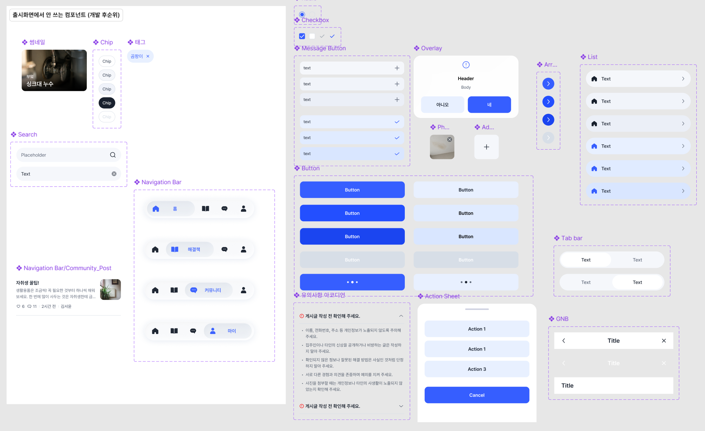

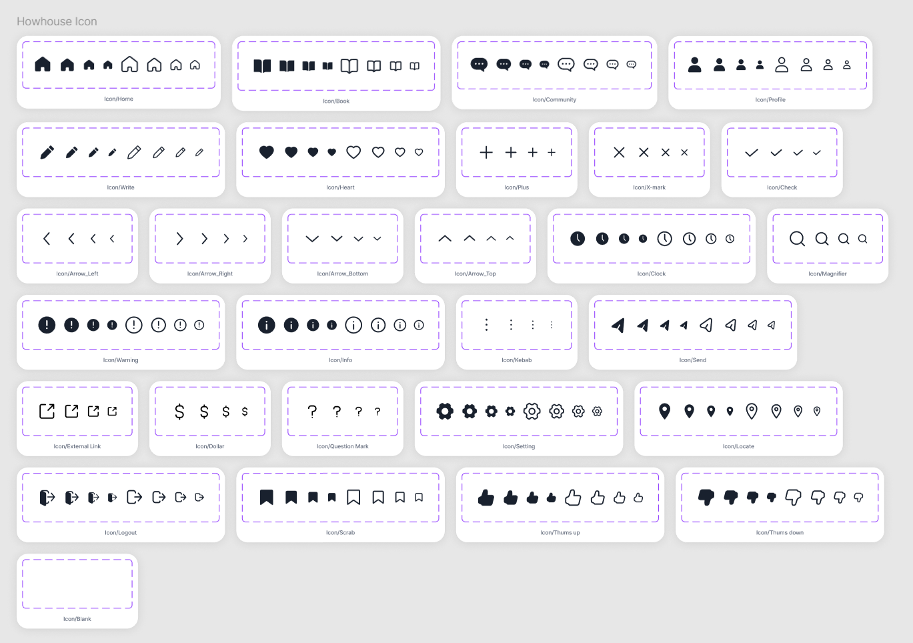

- 화면 전반의 라운드·간격·색상·타이포그래피 통일

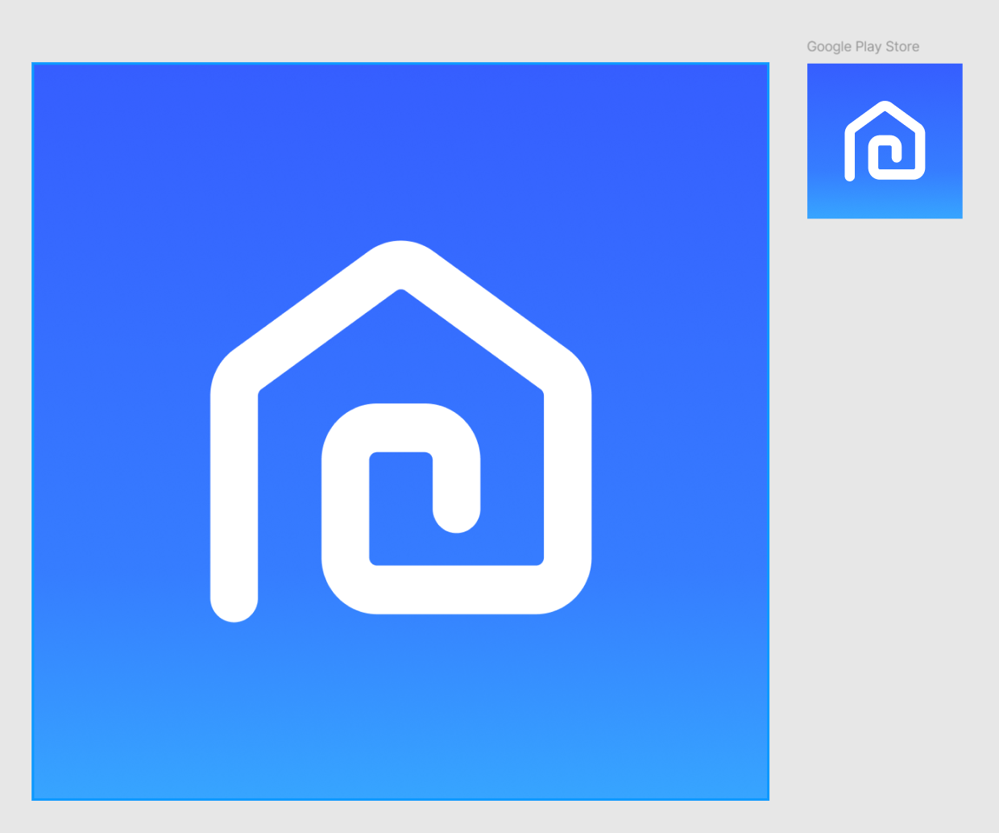

- 홈 디자인 공동 수정 및 누락된 화면 흐름 점검

- iOS 기준 시안을 Android 규격으로 조정하고 반응형 레이아웃으로 수정

- 팀원들과 함께 Android 출시 용으로 기능을 줄이면서 수정해야 했던 화면 및 디자인 수정

- 안드로이드 제출 규격에 맞게 두 종류(스토어/홈)의 앱 아이콘을 제작함 →→→→→→→

**화면 기능정의 원안·사례 영상·외부 url 약관 문서 작성**

- 내가 전 화면 흐름 및 디자인을 점검했기에 그 과정에서 생각했던 화면 제작 의도를 바탕으로 기능정의 원안을 수기로 작성하고, 누락된 기능은 공동으로 논의함. (AI를 활용한 최종 기능정의 문서 작성은 팀원 담당)

- 담당 문제 사례별 관련 YouTube 영상 조사 및 AI를 활용한 영상 적합도 검토

- 약관·개인정보 관련 Notion 문서 초안 작성 및 앱 연결용 URL 준비 ([링크](https://app.notion.com/p/xamxam33/40902821a7f3809aa417d65279f87c37) – 안에 다른 페이지들도 연결되어 있음)

**웹 개발 환경·공통 컴포넌트·디자인 문서 구성**

- React·TypeScript·Vite 개발 환경과 GitHub 폴더·작업 브랜치 구조 구성

- 색상·Pretendard·아이콘 적용 및 출시용 공통 컴포넌트 구현 – 공통 코드 구조 마련, 인터렉션도 적용됨

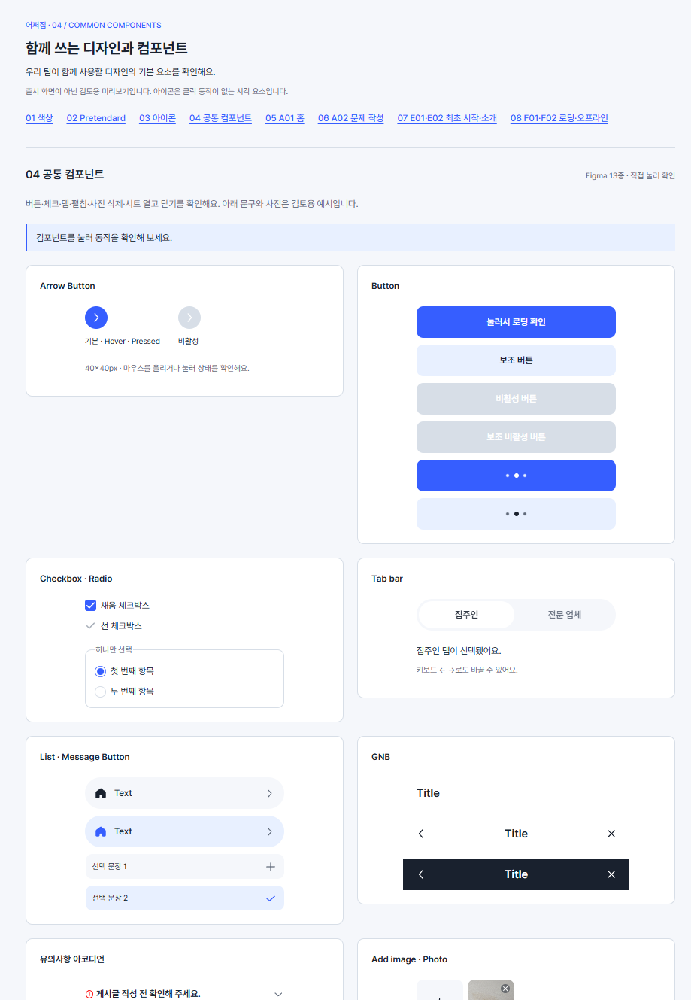

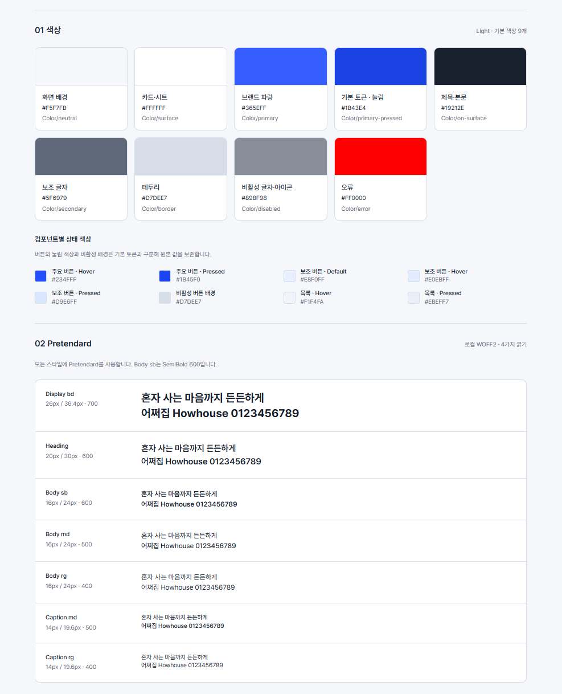

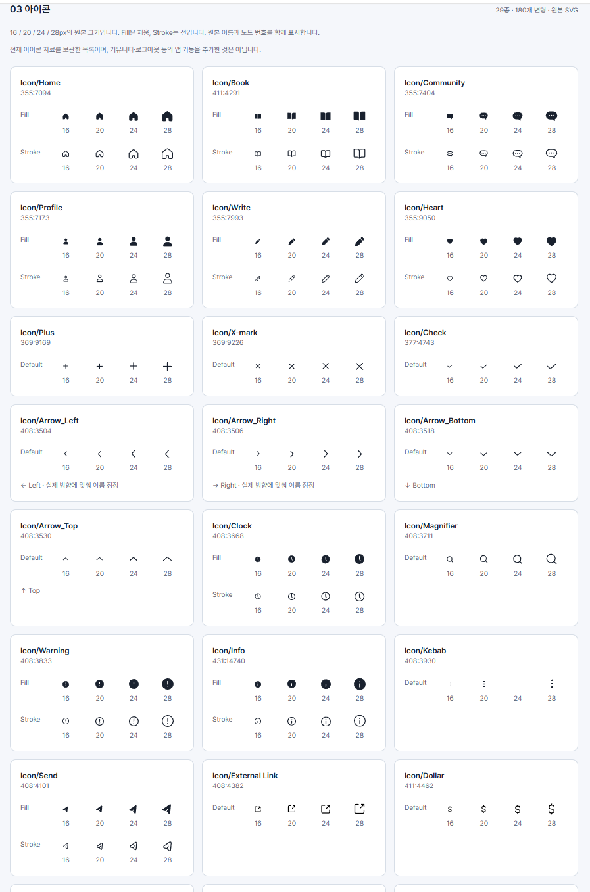

- 공통 컴포넌트·아이콘의 동작을 확인할 수 있는 미리보기 구성 – 위 사진이 미리보기 페이지

- [DESIGN.md](https://github.com/sowon24-design/Howhouse/blob/5d25e66db8801ad3aaf149b0be227fd22eaf4c89/DESIGN.md) 및 [CONTRACT.md](https://github.com/sowon24-design/Howhouse/blob/5d25e66db8801ad3aaf149b0be227fd22eaf4c89/src/components/CONTRACT.md)를 작성하고 프로젝트에 적용

**A·D·E·F 화면과 입력·저장 기능 구현**

- A 화면: 홈, 문제 입력·사진 첨부, 분석 중·분석 실패 화면 구현

- D 화면: 마이, 닉네임 수정, 정보·약관·문의 화면 및 외부 링크 연결

- E·F 화면: 환영·소개·약관 동의·닉네임 설정, 로딩·오프라인 화면 구현

- 입력 검증, CTA 활성 조건, 사진 추가·삭제, 선택·복사·알림 기능 적용

- 닉네임·최초 설정 완료 여부의 기기 저장, 온보딩·홈 진입 분기와 테스트용 초기화 기능 구현

- 재입력 시 문제 입력 글·사진 보존 및 홈 이동·새로고침·앱 프로세스 종료 시 문제 입력 초기화 규칙 적용

**홈·B 화면·AI 분석 결과 연결**

- 홈 카테고리·인기 문제와 B 화면(팀원이 담당한 화면)을 연결, 진입 경로별 뒤로가기·완료 동작 정리

- 실제 분석 API를 문제 입력 화면과 연결하고, 분석 시작·성공·실패·취소에 따른 화면 이동 구현

- 미리 준비한 사례와 새로 생성한 분석 결과를 B02 해결 방법과 B03 문의 메시지 화면에 연결

- 공개 서버·인증 설정을 웹과 시험 APK에 적용하고, 무료 샘플·실제 API 모드와 테스트 경로 구성

- 생성 결과의 기본 이미지·딤·하단 CTA 적용 및 기존 사례와 생성 결과의 표시 차이 정리

**Android 앱 시스템 기능 연결**

- Capacitor 기반 Android 프로젝트 구성, Android Studio·에뮬레이터 준비 및 APK 빌드·설치

- 시스템 키보드에 따른 입력 화면·CTA 위치 조정과 Android 뒤로가기 우선순위 연결

- 시스템 카메라·사진 선택기 연결, 사진 최대 5장 첨부와 선택 취소·권한 거부·읽기 실패 처리

- 네트워크 단절 감지와 F02 복구 연결, 분석 취소·입력 보존·자동 재분석 금지 규칙 적용

- 캡처용 개발 도구 숨김 및 최신 화면이 반영된 APK 준비

↓ Android 에뮬레이터에서 연 주요 화면 캡쳐 사진

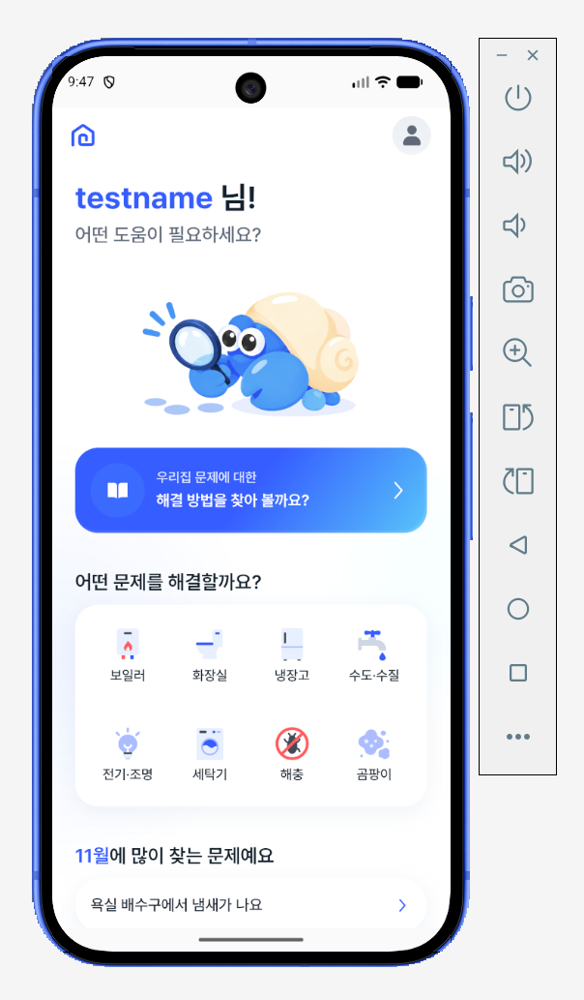

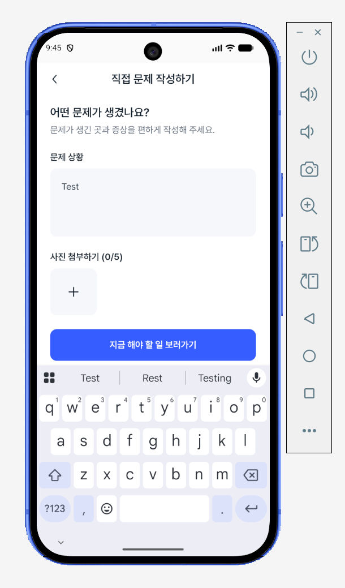

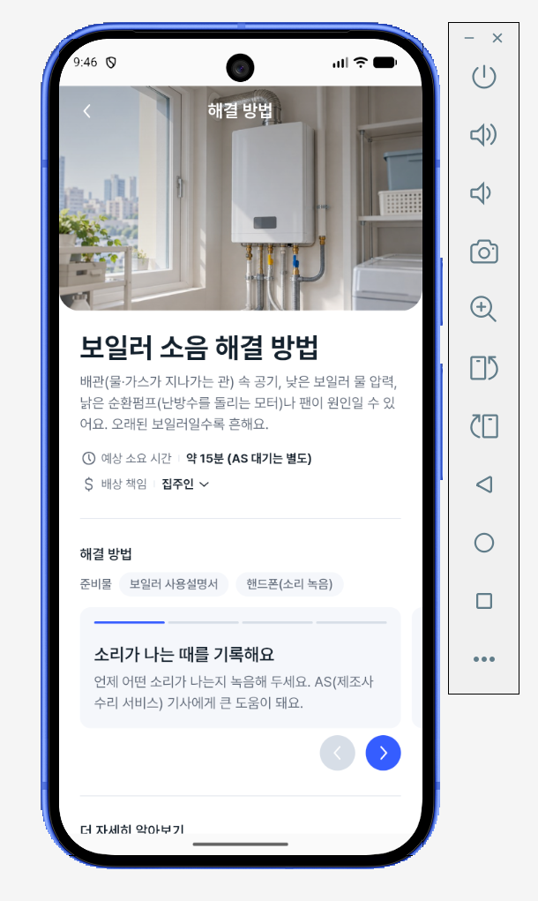

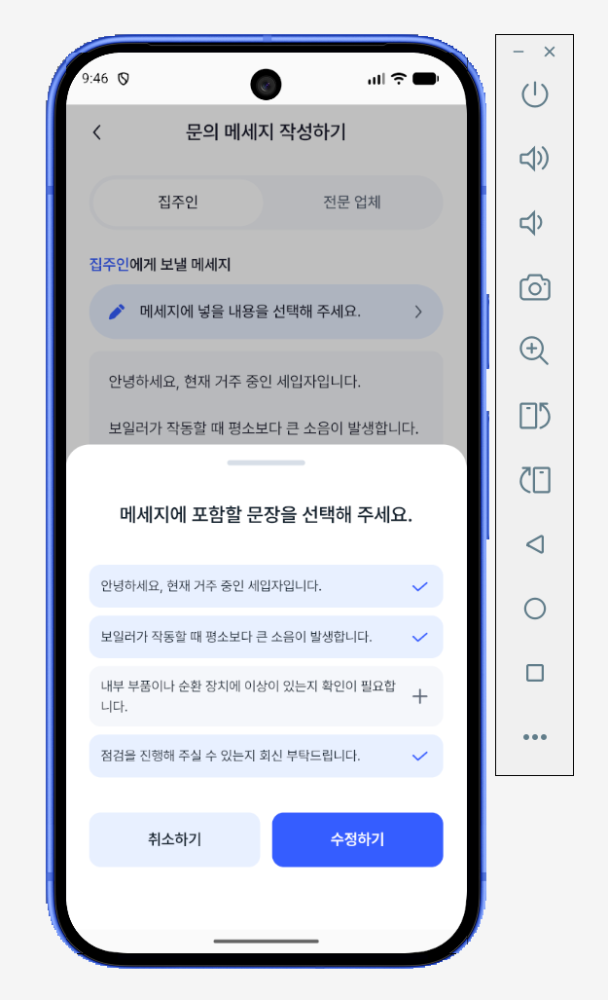

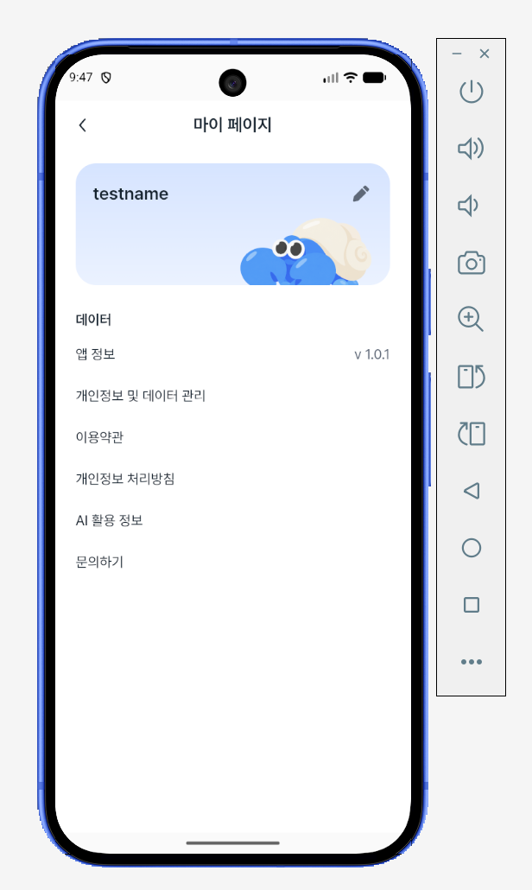

**팀원이 담당한 B화면을 통합하며 전체 화면과 안 맞는 B화면의 인터렉션 수정**

- 온보딩 등장, 로딩, 탭, 아코디언, 바텀시트와 알림 모션 조정

- 버튼·아이콘·목록의 눌림 효과 통일 및 불필요한 기본 탭 표시·입력창 테두리 제거

- B02 헤더 색 전환, 해결 단계 스와이프, 평가 선택 고정과 의견 시트 동작 보완

- B03 복사 알림을 다른 화면과 같은 모션으로 통일

- 통합 후 화면 잘림·가로 스크롤·CTA 위치·화면 전환 및 복귀 오류 수정

- 배경 그라디언트·딤 농도 등 실제 실행 화면의 시각 표현 보정

**팀원 작업 인계·GitHub 통합·QA 준비**

- 초반 팀원별 브랜치 세팅 및 작업 폴더·공통 코드 사용 안내와 시작용 프롬프트 작성

- 화면 간 전달 데이터·콜백·입력 보관·취소·복귀 규칙 협의 및 인계 내용 정리

- 웹·에뮬레이터에서 주요 사용 흐름 확인 및 빌드·자동 검사 결과 점검

- [화면별 QA 체크리스트](https://docs.google.com/spreadsheets/d/1B9NxtAPyyvZTQXgxfgz1HczjyNJKX-ZrFbzg-WpfY44/edit?usp=sharing)를 구글시트로 구성하고, 완료·미완료 항목과 담당별 후속 작업 정리 (QA 진행은 10주차때 진행)

### 결과 (커밋/PR/이슈 링크로 근거 남기기)

- 완료: 공통 디자인 기반, 담당 화면과 팀 화면 통합, 주요 인터랙션, Android 기본 시스템 연결, 시험 서버 연결 설정, APK 설치·캡처 준비

- 팀 기록으로 확인: 서버 인증 오류 해결 후 실제 생성 분석 성공, 예상 시간·책임 참고·분리된 문의 문장 표시 확인. 직접 구현한 부분과 구분

커밋과 PR은 AI와 협업한 구현 결과의 근거이며, 개인 기여에는 요구사항 결정·직접 검수·수정 지시·팀 통합이 포함됨.

- [PR #27 - 공통 디자인 기반·컴포넌트](https://github.com/sowon24-design/Howhouse/pull/27)

- [PR #28 – 담당 화면·연결 안내](https://github.com/sowon24-design/Howhouse/pull/28)

- [커밋 4573450 – 화면 통합·기기 저장·Android 기능](https://github.com/sowon24-design/Howhouse/commit/4573450)

- [PR #37 – B 화면 인터렉션·시험 APK 설정](https://github.com/sowon24-design/Howhouse/pull/37)

- [PR #41 – 화면 스크롤·결과·피드백 UI 개선](https://github.com/sowon24-design/Howhouse/pull/41)

- 프로젝트 기록: src/app-screens/FLOW_CHECK.md, android/README.md, docs/TRIAL_APK_SETUP.md, src/solutions/INTEGRATION.md

- [팀 QA 체크리스트](https://docs.google.com/spreadsheets/d/1B9NxtAPyyvZTQXgxfgz1HczjyNJKX-ZrFbzg-WpfY44/edit?usp=sharing)

*PR #39의 프롬프트·생성 계약 보완과 PR #42의 피드백 서버 구현은 팀원 작업으로 구분. 캡처용 개발 도구 숨김·복원 설정은 현재 로컬 변경이므로 위 PR에 포함된 것으로 표기하지 않음.

